# Lieutenant Fizz 2

<p align="center">
  
</p>

<p align="center">
  <a href="https://github.com/ScottMorris/lieutenant-fizz-2/actions/workflows/ci.yml"></a>
  
  
  
</p>

*Lieutenant Fizz 2* is the start of **Episode 2** of the Keen-style platformer series, and the simulation that Episode 3 will reuse. It is one game with two first-class presentations, **Web** and **DOS**, built in parallel from a deterministic Rust core. Fizz 1 stays where it is as the original and the reference; Fizz 2 learns from it.

> **Status:** foundations. The repository has its house rules, the `fizz-sim` fixed-tick and state-hash crate, the architecture and the findings of an earlier proof of concept. There is nothing to play yet. [`docs/ARCHITECTURE.md`](docs/ARCHITECTURE.md) has the plan.

## The story so far

Ben "Lieutenant Fizz" Blaze followed his cousin Billy to Planet Zargoth, fought through the Crater Fields, the Crystal Caves and Mildred's Citadel, and freed Billy, who left on a lead of his own. Now Ben is on his own. The Zargs are raiding Earth's chocolate, Mildred is back with a bigger plan to drain Earth's cocoa and fill Zargoth's rivers for good, and Billy is only a voice on the comms.

Episode 2 takes Ben through an overworld, an inner world and an underworld, with levels that climb and descend through mazes of keycards and doors, new gadgets beyond the pogo stick, and enemies in the style of the planet, such as a chicken that has been Zargified. One level takes place at a lighthouse. The full story and series plan live in the [main game's documents](https://github.com/liminal-hq/lieutenant-fizz/blob/main/docs/SERIES.md).

## What it is for

- **One game, two presentations.** The Web build is the rich one: real lighting, a zoom-out level map, an Undertone score. The DOS build is the bonus: a 486DX is the floor, and it may cut content but never limits the design.
- **A simulation both can trust.** Fixed 60 Hz steps, the Fizz 1 numeric model, and a per-tick state hash that native, Web and DOS builds must agree on.
- **Intent flows up, lowering flows down.** The game describes what is in a scene and what the music means. Each presentation projects that down to what its hardware can do, and offline tools do the lossy conversion.
- **Reusable beyond one episode.** The rules foundation is built so Episode 3 can reuse it.

## Platforms

| Platform | Role | Status |
| --- | --- | --- |
| Web (and Tauri on Linux, Windows, macOS and Android) | Rich presentation, authoring and playtest | Planned |
| DOS (486DX, VGA, AdLib) | Bonus presentation on a Rust-on-DOS runtime | Planned |

## Repository layout

| Path | What it holds |
| --- | --- |
| `crates/fizz-sim` | The deterministic rules foundation: the 60 Hz tick and the state hash |
| `docs/ARCHITECTURE.md` | Layers, crate plan, parity policy, and what is mirrored from where |
| `docs/POC-1-FINDINGS.md` | What the earlier proof of concept settled and what it did not |
| `docs/SCENE-CONTRACT.md` | A sketch of the scene boundary between rules and presentations |
| `tools/` | `check.sh` and the licence-header and documentation checks |
| `assets/` | The README banner |

## Getting started

```bash
tools/check.sh
```

This runs formatting, lints, tests, the licence-header check and the markdown style check. The toolchain is pinned in `rust-toolchain.toml`.

## Standing on other projects

Fizz 2 draws on several Liminal HQ projects and names each one where it uses it.

- [Lieutenant Fizz](https://github.com/liminal-hq/lieutenant-fizz) is the behaviour, story and level reference. Its `f64`, fixed-step simulation is the numeric model Fizz 2 follows.
- [Desk](https://github.com/liminal-hq/desk) is the Rust-on-DOS foundation. Its hardware abstraction ideas are mirrored here for now and swapped for the real crates later.
- [Undertone](https://github.com/liminal-hq/undertone) is the audio library for the Web score.
- Fizz Level Studio, an experiment, is the level and overworld authoring tool, with its own script language.
- [Waypoint](https://github.com/liminal-hq/waypoint) and [Spindle](https://github.com/liminal-hq/spindle) set the repository conventions: the README shape, CI, release notes and labels.

## Conventions

Lieutenant Fizz 2 follows the [Liminal HQ](https://liminalhq.ca) conventions and copyright, and shares Fizz 1's palette, sense of humour and appetite for chocolate.

## Licence

Licensed under either of the [Apache License, Version 2.0](LICENSE-APACHE) or the [MIT licence](LICENSE-MIT), at your option.
