# Lieutenant Fizz 2 — Player's Manual

This manual is updated with every change a player can see or do, in the same pull request as the change. It describes the builds as they are today, not as they are planned. The rule is in the "Game Manual" section of [`AGENTS.md`](../AGENTS.md).

## What this is

Lieutenant Fizz 2 is a technical preview. Both the Web and the DOS versions play the first slice of the game: one small vertical maze with a red key, a red door, a chicken, a snack nook with a blue key and door, and an exit, using the pogo stick, the jump and the Fizz Blaster from Lieutenant Fizz 1 (see [The slice on DOS](#the-slice-on-dos) and [The Web slice](#the-web-slice)). There is no story, and the only menus are the Paused and Options screens on the Web and on DOS; the only sounds so far are the chicken's cluck and a looping placeholder song, on DOS with an AdLib or a Sound Blaster (see [Hearing the cluck on DOS](#hearing-the-cluck-on-dos)) and on the Web (see [Sound on the Web](#sound-on-the-web)). The two versions exist to prove that the game behaves identically on both.

## Running it

### Web

Build the page with `tools/build-web.sh`, then serve the `dist/web` folder with any static file server and open it in a browser. Click the page or press a key once before you expect sound; browsers do not allow sound before that. The build needs the Rust toolchain from the repository and a matching `wasm-bindgen` command-line tool; [`PLATFORM.md`](PLATFORM.md) has the exact version.

### DOS

Build the program with `tools/build-dos.sh`, which writes `FIZZ2.EXE` and `CWSDPMI.EXE` into `dist/dos`. Keep the two files together and run `FIZZ2.EXE` in DOSBox or js-dos. It needs a VGA display, and it targets a 486-class PC (the slowest machine in mind is about a 486DX2-66, which has not been tried on real hardware; so far it has run only in DOSBox). Sound on DOS is described under [Choosing your sound on DOS](#choosing-your-sound-on-dos); the program also shows a machine check first if you ask for it with `/CHECK`. The build needs the DOS toolchain described in [`PLATFORM.md`](PLATFORM.md); you do not need a C compiler.

## Controls

There are two sets of keys, and you use one at a time. Keen is the default on the Web and on DOS.

| Action | Keen keys (default) | Modern keys |
| --- | --- | --- |
| Move | Arrow keys | Arrow keys or `W` `A` `S` `D` |
| Jump | Ctrl | `Z` |
| Pogo stick | Alt | `X` |
| Fizz (fire) | Space | `C` or Space |
| Pause menu (Resume, Options, Quit to DOS or Restart) | Esc, and the Pause key on the Web | Esc, and the Pause key on the Web |
| Fullscreen | `F` (Web only) | `F` (Web only) |
| Sound on or off | `M` (Web only) | `M` (Web only) |
| Captions on or off | `V` (Web only) | `V` (Web only) |

In the slice every key in the table does something; [The slice on DOS](#the-slice-on-dos) and [The Web slice](#the-web-slice) say what, and the two versions use the same keys for the same actions. Keys from the other set do nothing, so `W` does not move you under the Keen keys.

On DOS, Esc opens the pause menu, and its last row, Quit to DOS, leaves the game; see [Options on DOS](#options-on-dos). On the Web there is no quit key; close the tab.

### Choosing your keys

- **Web:** the Keys row of the Options screen (`Esc`, then Options; see [Options on the Web](#options-on-the-web)) switches between Keen and Modern, and the panel (`H`) lists the keys in use. The page remembers your choice on this browser, if the browser allows it to.
- **DOS:** start with `FIZZ2.EXE /MODERN` for the Modern keys, or `FIZZ2.EXE /KEEN` for the Keen keys. With neither, you get the layout saved in `FIZZ2.CFG`, and the Keen keys if there is no file.

### Captions

When the chicken clucks, its beak opens and its words float above its head for about a second, rising a little and fading, as the sound words do in Lieutenant Fizz 1. The words depend on the cluck: `buh-gawk!`, `bwuk`, `bwuk-bwuk` or `bwuk, bwuk` (on the Web they are text over the picture, as in Lieutenant Fizz 1; on DOS they are drawn as pixels in Lieutenant Fizz 1's own small letters, small and capital as written, though thinner and upright where the Web's are bold and slanted), each in its own colour. The double clucks open the beak twice. The words stay with the chicken, so as it walks off the edge of the picture its words are cut off by the edge with it, and they are left out once it is more than a tile outside the picture. On a DOS machine with no sound at all, or with the sound turned off, these words are the only sign that the chicken has clucked.


*The Web build (commit 796602d) in headless Chromium at 1280 by 720, at tick 201, four ticks after the chicken's first cluck, with the HUD in the top left corner. The word is ordinary page text on top of the canvas, so it stays sharp at any window size.*

- **Web:** the Captions row of the Options screen turns them on and off, and so does `V`. They are on until you turn them off, and the page remembers your choice on this browser, if the browser allows it to.
- **DOS:** start with `FIZZ2.EXE /NOCAPTIONS` to turn them off, or `/CAPTIONS` for on, which is the default. It combines with the other options, as in `FIZZ2.EXE /MODERN /NOCAPTIONS`. With neither, the choice saved in `FIZZ2.CFG` is used.

Turning captions off hides only the words; the beak still opens.

Other things Ben does raise a word where they happen, in the colours of Lieutenant Fizz 1:

| Word | Colour | When |
| --- | --- | --- |
| `fzzt` | light cyan | A Fizz shot leaves the blaster |
| `click - no fizz` | grey | You press Fizz with no shots left |
| `fizzled` | light cyan | A shot stuns a chicken |
| `bonk` | white | You land on a chicken |
| `whoa!` | light red | Ben dies |
| `ta-da!` | light green | You reach the exit |
| `red gumdrop`, `blue gumdrop`, `green gumdrop` | red, blue, green | You pick up a key |
| `clunk` | white | A door opens with its key, or Ben bumps his head |
| `boing` | yellow | The pogo stick bounces off the ground |
| `crunch` | yellow | Ben takes a snack |

A jump has no word, but it has a sound. The same word is left out if it comes again within about a fifth of a second (so a fast run of shots does not pile up `fzzt`), at most six words show at once (a seventh replaces the first), and a word is left out if its spot is more than a tile outside the picture. Each word stays where it appeared while the view moves, rises a little and fades over about a second, on the Web and on DOS alike.

### Sound effects

Every one of those words has a sound that plays at the same moment, and so does the jump, as in Lieutenant Fizz 1: `fzzt` is a bright zap that falls, `fizzled` a short wobbling sputter, `bonk` a deep knock, `whoa!` a long falling cry, `ta-da!` a rising flourish that ends on a long bell-like note, the gumdrops three quick rising notes, `clunk` a low thud, `click - no fizz` a tiny high tick, `boing` a springy wobble, the jump a short rising chirp and `crunch` a noisy crackle with two quick notes. The chicken keeps its four clucks.

- The sounds play whether the captions are on or off, and a word that is left out because it repeats too soon still has its sound.
- When two things happen at once the sounds can overlap on the Web. On DOS the effects share one voice, so the newest sound cuts the one before it off, as in Lieutenant Fizz 1; for instance a snack taken as you leave the ground plays the snack's sound, not the jump's.
- Holding the Fizz button with no shots left clicks once, when you press it.
- The song does not stop or get quieter when you reach the exit; `ta-da!` plays over it.
- On the Web, press `H` for the panel and use the list "Hear an effect" under the hint: it plays any of the fifteen sounds by itself, at full volume and in the middle, so you can hear each one. The arrow keys step through the list, and `Esc` gives the keyboard back to the game. DOS has no such list.
- On DOS each sound is one voice and is a little thinner than on the Web: the layers, the noise and the bell tones are simpler, and on the PC speaker each is a plain beep with no volume.

Nobody has listened to the new sounds yet: what is described here is what they are meant to be.

### Where a cluck comes from

In the Enhanced way of playing, a cluck, and every other sound, comes from where it happens on the screen, as in Lieutenant Fizz 1. A chicken at the left of the picture is louder in your left ear and a chicken at the right is louder in your right, but never all the way: the far ear is still about a third as loud (ten decibels down), so the cluck does not vanish from one side. A sound that happens off the screen is quieter, getting softer as it gets further away and no softer than about 40 percent of the level (eight decibels down). A sound you make yourself, such as a jump, a shot or a snack, comes from near Ben, so it is close to the middle. What you hear depends on your sound:

- **A Sound Blaster Pro 2, 16 or later (`FX ch5+14`):** the sound is true stereo, panned and softened by its place. The place is chosen when the sound starts; it does not follow the chicken if it walks while a cluck sounds.
- **An AdLib, or an older Sound Blaster (`FX ch5`):** the sound is mono, so it cannot pan, but it is softer when it happens off the screen. A later Sound Blaster that you have chosen to play effects on AdLib plays the one voice in both speakers, softer at a distance.
- **The PC speaker (`FX speaker`):** the speaker has no volume and one output, so a sound is the same wherever it happens.
- **No sound (`/NOSOUND`):** silent.

On the Web the Options screen has a Placement row: Enhanced (the default) places each sound as above, using the width of your window as the width of the view, so the same chicken is panned less in a wide window. Classic plays every sound in the middle at full level, as the original game did. The page remembers your choice on this browser, if the browser allows it to, and `?audio=classic` or `?audio=enhanced` at the end of the page's address chooses for that visit, and the row then shows a `*` until you change it. DOS has no Classic setting yet; its Options screen will have one.

Nobody has listened to this yet: the numbers behind these descriptions are checked, the sound is not.

### Fullscreen and browser shortcuts

On the Web, press `F` or use the Fullscreen row of the Options screen to fill the screen, and press it again to leave. In fullscreen the browser keeps the first `Esc` for leaving fullscreen, so press `Esc` again, or the Pause key, to pause. A web page cannot stop a browser tab from acting on a few shortcuts: Ctrl+W closes the tab whatever the game does, and some desktops keep their own window and workspace shortcuts. In fullscreen, Chromium-based browsers (Chrome, Edge and similar) let the game keep Ctrl, Alt and the other game keys to itself; other browsers do not. If a shortcut keeps getting in your way, switch to the Modern keys, which do not use Ctrl or Alt.

### DOS modes

Add one of these after the program name, such as `FIZZ2.EXE /REPLAY`. With no mode, you get `/LIVE`. Add `/MODERN` as well, or by itself, to use the Modern keys in `/LIVE`, as in `FIZZ2.EXE /MODERN`; `/KEEN` does the same for the Keen keys. `/NOCAPTIONS` and `/CAPTIONS` work the same way; see [Captions](#captions). So do `/FPS30`, `/FPS60` and `/FPSAUTO`, which choose how often the picture is drawn; see [Frame rate on DOS](#frame-rate-on-dos).

- `/LIVE` — you play the slice. Esc opens the pause menu (Resume, Options, Quit to DOS). The run ends when you choose Quit to DOS, or by itself after 30 seconds of real time (time spent in the menu counts), and then prints the final tick, the hash, and whether Ben moved from where he started.
- `/REPLAY` — plays a built-in run through the whole slice by itself, with no keyboard input: about 28 seconds in which Ben shoots and stomps the chicken, dies once on the spikes, takes the key, opens the door, plays in the snack nook (snacks, a head bump, the pogo, the empty blaster, the blue key and door) and walks into the exit. It then prints the list of hashes it reached and a few lines about the machine, including `EXIT yes` when Ben got out. Use it to check that your copy agrees with the Web version, and to watch the level without playing it.
- `/BENCH` — times your computer. It plays the same built-in run as fast as it can, with no waiting, and then prints how many microseconds each picture took for the game's rules, the drawing and the copy to the screen, next to the 16,667 microseconds that one tick at 60 a second allows. If the drawing figure is much larger than that, the game will run slower than 60 pictures a second on your machine. It also prints a line that times a short fixed loop of simple steps, which shows how fast your computer ran the test. It does not wait between pictures, so it is usually over sooner than `/REPLAY`, and it ends with `EXIT yes` when Ben got out. Add a number, as in `/BENCH 120`, to time only that many pictures from the start of the run; it is quicker, and it does not reach the exit.
- `/PROBE` — looks at your computer and tells you what it found, without playing or drawing anything and without waiting for a key. It prints one line each for your screen (`vga`, `ega`, `cga` or a monochrome adapter), whether a mouse and a joystick are connected, what kind of music chip you have (`none`, `opl2`, `dualopl2` or `opl3`), your Sound Blaster (`none`, or its version and port), the `BLASTER` setting, whether you have a maths chip, your processor (`386`, `486` or `586` for a Pentium or later) and how much memory is free. It also prints a code for the start-up screen the game will show for your computer and how much memory the program holds, and ends with `EXIT yes`. Use it to see how the game sees your computer; the sound uses these results, and `/CHECK` shows them on a start-up screen.
- `/CHECK` — shows a start-up check screen in text mode: what your computer has (screen, keyboard, mouse, joystick, sound, processor, maths chip, memory) and which sound the game would use. It only shows; there is nothing to change on it. Press Enter to go on and play (it then runs as `/LIVE`), or Esc to quit. Enter does nothing while the screen says something the game needs is missing (a VGA display or a maths chip). Each sound line is in one of three states: dim when that device is not on your computer, normal when it is there but not used, and bright (a white-on-blue bar in colour, an inverse bar on a monochrome screen) when the game will use it. It waits for a key, so use `/PROBE` or `/CHECKCELLS` in scripts.
- `/CHECKCELLS` — draws the same check screen, reads it back from the screen memory, restores the text mode and prints it as hexadecimal, 25 lines of 80 cells (`CELLROW 00 ...`), after the `PROBE` lines. It needs no key. It is for testing that what the screen holds is what the game meant to draw.

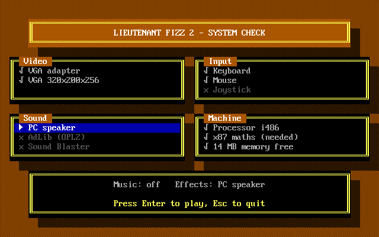

*The check screen, drawn by `FIZZ2.EXE /CHECKCELLS` in DOSBox Staging (a 486 with VGA, mouse, no joystick and no sound card, so the PC speaker is the one sound line in use) and redrawn from its screen memory with `tools/render-cells.py` at commit b238803.*
- `/PANIC` — makes the program stop on purpose, to show that it puts the keyboard, timer and screen mode back as it found them. It is a test, and it exits with status 3.

### Command-line switches

Type `FIZZ2.EXE /?` (or `/HELP`, or `-?`) to see every switch on one screen. It prints the list and stops, without starting the game or changing your screen, and it does the same even if you add other switches, as in `FIZZ2.EXE /? /LIVE`. The list groups them as modes (`/LIVE`, `/REPLAY`, `/BENCH`, `/CHECK`, `/CHECKCELLS`, `/PROBE`), options (`/MODERN`, `/KEEN`, `/CAPTIONS`, `/NOCAPTIONS`, `/FPS30`, `/FPS60`, `/FPSAUTO`) and sound (`/MUSIC:x`, `/FX:x`, `/ADLIB`, `/SB`, `/SPEAKER`, `/NOSOUND`). Capital or small letters both work.

The help screen, as `FIZZ2.EXE /?` prints it:

```
Lieutenant Fizz 2 for DOS. Usage: FIZZ2.EXE [mode] [switches]; case is ignored.
Modes (the first one given is used; /LIVE is the default)
  /LIVE         Play the slice from the keyboard; Esc pauses
  /REPLAY       Run the built-in script and print its transcript
  /BENCH [n]    Time the script (first n ticks) and print the costs
  /CHECK        Show the machine check; Esc leaves, Enter plays
  /CHECKCELLS   Draw the check screen and print its cells; no key
  /PROBE        Print what the machine has: video, sound, processor
  /?            Show this help (also /HELP and -?); nothing else runs
Options (for this run; where one has an opposite, the last one given wins)
  /MODERN       Use the Modern keys (W A S D, Z X C) instead of Keen's
  /KEEN         Use Keen's keys, even if FIZZ2.CFG saved the Modern ones
  /CAPTIONS     Show the chicken's captions
  /NOCAPTIONS   Hide the captions
  /FPS30        Draw 30 frames a second (the game itself still runs at 60)
  /FPS60        Draw 60 frames a second
  /FPSAUTO      Draw 60 or 30 a second, whichever the machine keeps up with
Sound (for this run only; FIZZ2.CFG keeps your saved choice)
  /MUSIC:x      Music device: ADLIB, SB or OFF
  /FX:x         Effects device: ADLIB, SB, SPEAKER or OFF
  /ADLIB        Music and effects on the AdLib chip
  /SB           Music and effects on the Sound Blaster
  /SPEAKER      Effects on the PC speaker, no music
  /NOSOUND      No music and no effects
Exit status: 0 after help, 2 for a switch FIZZ2.EXE does not know.
```

If you type something the game does not know, such as `FIZZ2.EXE /LIVEE`, it prints one line naming it, `FIZZ2.EXE: unknown switch /LIVEE, try FIZZ2.EXE /?`, and stops with exit status 2 instead of starting. The same goes for a sound switch with a value it does not know, such as `/MUSIC:FOO`. Three testing switches, `/PANIC`, `/CFGTEST` and `/OPTIONS` (which opens the Options screen at once, over the first picture of the level, and leaves when you press Esc), work but are left out of the list because they are not for playing.

### Choosing your sound on DOS

The DOS version plays the sound effects (the chicken's cluck and the others in [Sound effects](#sound-effects)) and, with an AdLib or a Sound Blaster, a looping song. The song is Crater Fields, Lieutenant Fizz 1's level music, used here as a placeholder to test the music; it is not an official Episode 2 track and it will be replaced. The PC speaker plays the effects but never the music, so on a computer with no AdLib or Sound Blaster there is no music. The game works out how to play it from your computer and your choices, and `/LIVE`, `/REPLAY` and `/PROBE` print the answer as one line, such as `SOUND MUSIC opl3 FX ch5+14`. `MUSIC` is `off`, `opl2` (an AdLib or the music chip of an older Sound Blaster) or `opl3` (a Sound Blaster Pro 2, 16 or later). `FX`, the sound effects, is `off`, `ch5` (the AdLib chip), `ch5+14` (the Sound Blaster's pair of channels, 5 and 14) or `speaker` (the PC speaker, which cannot play music). Music and effects are chosen separately. If you ask for something your computer does not have, the game falls back to the nearest thing it does have and adds a word saying why, such as `music-sb-to-adlib`; it never stops.

You can choose for one run with these options, which combine with the other options (`FIZZ2.EXE /MODERN /NOSOUND`) and work in any letter case:

- `/MUSIC:ADLIB`, `/MUSIC:SB` or `/MUSIC:OFF` — the music device. `SB` means the Sound Blaster's stereo chip, which plays the song in stereo with extra voices; `ADLIB` plays the plainer one-speaker version, and `OFF` turns the music off.
- `/FX:ADLIB`, `/FX:SB`, `/FX:SPEAKER` or `/FX:OFF` — the sound effects device.
- `/ADLIB` — AdLib for both. `/SB` — Sound Blaster for both. `/SPEAKER` — effects on the PC speaker and no music. `/NOSOUND` — no sound at all.

When two options disagree, the last one wins.

To keep a choice between runs, the game reads a small file called `FIZZ2.CFG` from the folder you start it in. It also holds a frame-rate choice (see [Frame rate on DOS](#frame-rate-on-dos)), whether the screen shakes and spins when Ben dies (Motion: Full or Reduced), how sound effects are placed (Enhanced, or Classic with every effect centred at full volume), the captions (On or Off) and the key layout (Keen or Modern). When you ask for none of these on the command line, the file's choice is used, and a choice you give on the command line wins over the file for that run only. `/KEEN`, `/MODERN`, `/CAPTIONS` and `/NOCAPTIONS` are the switches for the last two. The game writes the file itself when you leave the Options screen after changing something; see [Options on DOS](#options-on-dos). A value in the file that the game does not understand resets only that one choice to its usual setting. Older files, from earlier builds, are still read.

### Frame rate on DOS

The game always works out the world 60 times a second, so Ben jumps the same way, the chicken clucks at the same moment and the sound plays the same on every computer. What changes is how often the screen is redrawn. At 60 the picture is redrawn after every step. At 30 it is redrawn after every second step, so each picture stays on the screen for two steps: movement looks a little steppier, as in an older game on a slower machine, but nothing about the play changes, and keys are still read every step. A slow computer that cannot finish a picture in a sixtieth of a second looks smoother at a steady 30 than at an uneven 40 or 50.

You can choose for one run with these options, which combine with the other options and with any mode (`FIZZ2.EXE /FPS30 /MODERN`):

- `/FPS60` — draw after every step.
- `/FPS30` — draw after every second step.
- `/FPSAUTO` — the default. The game times the pictures it draws, 32 at a time. If they take longer than a sixtieth of a second each, but not more than about one and seven-tenths times as long, it moves to 30; if they take much longer than that (more than about one and eight-tenths times) or less than two-thirds as long, it moves to 60. In between it keeps the rate it has. It starts at 60, so a computer that keeps up never changes. A computer too slow even for 30 stays at 60 and draws as often as it can.

When two options disagree, the last one wins. A choice saved in `FIZZ2.CFG` (the file the sound choices use) is used when no option is given, and an option wins over the file. An option never changes the file.

`/LIVE` and `/REPLAY` end with a line such as `FRAMES 841 TICKS 1681 RATE 30 MODE 30`: how many pictures were drawn, how many steps were taken, the rate in use at the end and the mode (`auto`, `30` or `60`). At 30 the first number is about half the second. `/BENCH` does not use the frame rate: it draws every step and times it.

### Hearing the cluck on DOS

What you need depends on the `FX` word of the `SOUND` line. With `ch5` you need an AdLib or any Sound Blaster, with `ch5+14` a Sound Blaster Pro 2, 16 or later (the game switches its chip to the stereo mode and plays the effects in stereo, as described under [Where a cluck comes from](#where-a-cluck-comes-from)), and with `speaker` only the PC speaker that every PC has. With `off`, or with no sound card and `/NOSOUND`, the effects are silent. In short, the effects play on the OPL3 pair, on OPL2 or on the PC speaker, whichever the computer has. The game picks the best of these on its own unless you ask for another with the options above. When the game ends, or stops because something went wrong, it silences the chip and the speaker and puts the Sound Blaster back in its ordinary mode.

The music starts when the game starts and loops until it ends. The effects keep their two voices to themselves, so the music never takes them. The music never changes the game: the same moves give the same `TICK` and `HASH` with the music on or off.

The run prints one more line when it ends, such as `AUDIO WRITES 5221 SPEAKER STEPS 0` (that is the built-in run on an AdLib: 5,221 on channel 5, 10,382 on the stereo pair and 1,213 speaker steps on the PC speaker). It counts what the game sent to the chip for the sound effects and to the speaker, which is how a run with no ears can tell which of them played: a chip shows a number of writes (the stereo pair on a Sound Blaster Pro 2 or later shows about twice as many as channel 5 alone, because it plays each effect on two channels), the speaker shows steps, and a silent run shows zero for both. A second line, such as `MUSIC SONG crater ARR opl3 TICKS 11833 WRITES 1530 LOOPS 0 HASH 32fd5cf1`, says which version of the song played (`opl2`, `opl3` or `off`) and counts what it sent to the chip, so a run with no ears can tell that the music played; `off` means it did not, and the counts are zero. Nobody has listened to the DOS music yet, on a real computer or in DOSBox. The sound does not change the game: the same moves give the same `TICK` and `HASH` with the sound on, off or on the speaker. The game's timer now runs at about 560 times a second, which the sound needs, and it still advances the DOS clock at its usual rate. Nobody has heard the effects on a real computer yet. If you have no file, every choice is "Auto", which means the best the computer has. An option on the command line always wins over the file, and never changes it. If the file is damaged or from something else, the game uses Auto and the `SOUND` line says so (`cfg-length`, `cfg-magic`, `cfg-version`, `cfg-music`, `cfg-effects` or `cfg-framerate`). The file's layout is in [`DOS-CHECK.md`](DOS-CHECK.md#settings-file-and-flags).

### Options on DOS

Press Esc while you play to open the pause menu: Resume, Options and Quit to DOS. The picture stops and darkens behind it, and the music keeps playing. Up and Down choose a row (they wrap round), Enter or your Jump or Fire key chooses it, and Esc or your Pogo key goes back, which from the pause menu means Resume. Choosing Options opens the Options screen over the same darkened picture.

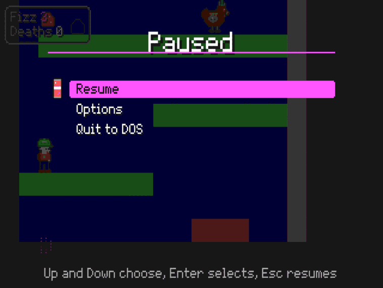
*The Paused menu in the DOS build (commit 796602d), `FIZZ2.EXE /LIVE` in DOSBox Staging under a virtual display, after Esc was typed.*


*The Options screen in the DOS build (commit 796602d): `FIZZ2.EXE /LIVE` in DOSBox Staging under a virtual display, after Esc, Down, Enter and Down were typed, with no card and no switches, so Music is `Auto (off)` and Effects `Auto (PC speaker)`. It is a capture of the running game; a row set by a switch also shows a star and a note, described below.*

On the Options screen Up and Down choose a row, Left goes back one choice and Right, Enter, Jump and Fire go forward one (past the last choice it wraps to the first), and Esc or Pogo goes back to the pause menu. The Modern keys work the same way, with `W` and `S` for Up and Down and `A` and `D` for Left and Right. The rows are:

- **Music** and **Effects** — Auto, the Sound Blaster, the AdLib, the PC speaker (Effects only) or Off. Auto shows what it would use on your computer, such as `Auto (Sound Blaster)`. A device your computer lacks is skipped, and the sound changes at once, so you can hear the result before you leave the screen.
- **Sound placement** — Enhanced or Classic (see [Where a cluck comes from](#where-a-cluck-comes-from)).
- **Frame rate** — Auto, 60 or 30 (see [Frame rate on DOS](#frame-rate-on-dos)). Auto shows the rate it is drawing at, as `Auto (60 Hz)`.
- **Motion** — Full or Reduced: whether the screen shakes and Ben spins when he dies.
- **Captions** — On or Off: the words above a chicken when it clucks.
- **Keys** — Keen or Modern. The new keys work from the next key you press.
- **Back** — returns to the pause menu.

Every change takes effect as you make it. When you leave the Options screen after changing something, the game saves your choices in `FIZZ2.CFG`, the file described under [Choosing your sound on DOS](#choosing-your-sound-on-dos). A screen you visit without changing anything writes nothing. If the file cannot be written (the disk is full or write-protected, or the file is read-only), the pause menu shows `Could not write FIZZ2.CFG` in light red, your changes still hold for the rest of this run, and the game carries on.

A row with a star after its value, as in `Auto (60 Hz) *`, was set by a command-line switch for this run (`/FPS30`, `/MUSIC:ADLIB`, `/MODERN` and the others), and a line at the bottom says so. You can still change that row, and the change applies to this run, but the game never saves a switch: the file keeps the value it had for that row. Once you change a starred row, its star goes.

While the pause menu or the Options screen is up, the game itself is held: no time passes for Ben, the chicken or the clock, and when you resume the game carries on from the same moment. The 30-second limit of `/LIVE` is wall-clock time, so a game left on a menu still ends by itself.

The switches that stand for each row are in this table; for each row the file's choice is used when no switch is given.

| Row | Switches that set it for one run |
| --- | --- |
| Music | `/MUSIC:ADLIB`, `/MUSIC:SB`, `/MUSIC:OFF`, `/ADLIB`, `/SB`, `/SPEAKER`, `/NOSOUND` |
| Effects | `/FX:ADLIB`, `/FX:SB`, `/FX:SPEAKER`, `/FX:OFF`, `/ADLIB`, `/SB`, `/SPEAKER`, `/NOSOUND` |
| Sound placement | none |
| Frame rate | `/FPS30`, `/FPS60`, `/FPSAUTO` |
| Motion | none |
| Captions | `/CAPTIONS`, `/NOCAPTIONS` |
| Keys | `/KEEN`, `/MODERN` |

It has not been tried on a real computer: how long the save takes on a floppy disk, and how the keys repeat when you hold one down in the menu, are untested.

## The slice on DOS


*Screenshot of the DOS build (commit 796602d) with the slice, `FIZZ2.EXE /REPLAY` in DOSBox Staging, a moment after the built-in run starts. The emulator scales the 320 by 200 picture up.*

You are Ben, in a cut-down lighthouse of 32 tiles by 48. The screen follows you up and down and left and right. The sound effects play (see [Sound effects](#sound-effects) and [Hearing the cluck on DOS](#hearing-the-cluck-on-dos)) and, with an AdLib or a Sound Blaster, so does a looping placeholder song.

When you play with `/LIVE`, the DOS version waits for the screen to finish drawing before it shows each new picture, which keeps the picture from tearing. Nothing else about how it plays changes.

The small box in the top-left corner is the HUD, in Fizz 1's own letters. `Fizz` is how many Fizz shots you have left; the number is light magenta (grape, the colour Fizz 2 uses for everything Fizz) and turns light red when none are left. `Deaths` counts how many times you have died. The chip at the right of the box is the red key: an outline while the key is on the floor, the key itself while you carry it. The box is drawn only when one of those changes, so it costs next to nothing. The game steps are no longer counted on the screen; `/BENCH` and the transcripts still print them, and the Web page shows them in its panel.

### The level on DOS

You start on the floor of the left shaft, with spikes a few steps to your right. The shaft climbs by ledges of one-way platforms, bright green on the screen, which you can jump up through and land on from above. A chicken walks the long third ledge, and the red key lies at its far left end. Above that the ledges lead up to the red door, a brown door in the wall that divides the two shafts. Through the door a second shaft climbs again to a gallery in the open air, where a yellow exit stands behind a blue door; the gallery's right end is a snack nook (see [The snack nook](#the-snack-nook)). Touching the exit ends the level: the game shows `LEVEL CLEAR` and Ben stops.

Tiles are told apart by colour: dark blue is the wall behind the rooms, dark grey and light grey are solid blocks you cannot pass, bright green is a one-way platform, bright red is spikes, brown is the red door and the blue door (each has its own colour of gumdrop and door picture) and yellow is the exit. Snacks and keys are small pictures that bob in place.

### Moves

- **Walk and run:** the left and right arrows. Ben speeds up and slows down rather than stopping at once.
- **Look:** stand still on the ground and hold Up or Down by itself. After a fifth of a second Ben looks up or down, and over about a third of a second more the screen slides to show 3.6 tiles higher or lower than usual (if the level's edge is already at the edge of the picture, as on the floor of the first shaft, the view cannot slide that way and only Ben's pose changes). Let go and the view slides back in a third of a second. It works with the arrow keys in both layouts, and with `W` and `S` in the Modern layout; it does nothing while you are walking, in the air, on the pogo stick or holding Up and Down together. It is the same on DOS and on the Web.
- **Jump:** press Jump. A full jump rises a little over three tiles, enough to climb from one ledge to the next. Let go of Jump early to cut the jump short.
- **Pogo stick:** press Pogo to get on the stick and press it again to get off. On the stick Ben bounces by himself and you steer him in the air with the arrows; he cannot walk. Hold Jump as he lands for a much higher bounce. He squashes for a moment at the bottom of each bounce.
- **Fizz:** press Fizz to fire a bubble of fizz from the Fizz Blaster in the way Ben faces. Hold Up while you press it to fire straight up (even standing still), or Down while Ben is in the air to fire straight down; Down on the ground fires ahead. Ben shows a matching pose for a moment after each shot. You have five shots, and a shot that hits a wall or flies about a second just pops, with a small grape-coloured puff (light magenta) that swells and thins out for a third of a second. You get all five back after you die.

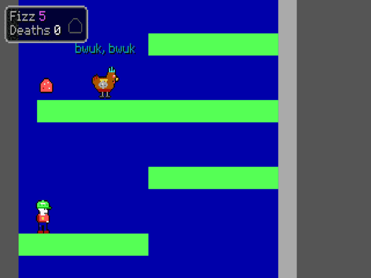

*DOS build (`FIZZ2.EXE /LIVE`, DOSBox Staging, headless under a virtual display): Ben has stood still on the first ledge holding Up for a second and a half, so the view has risen to show the chicken, which has just clucked "bwuk, bwuk". Commit 796602d.*

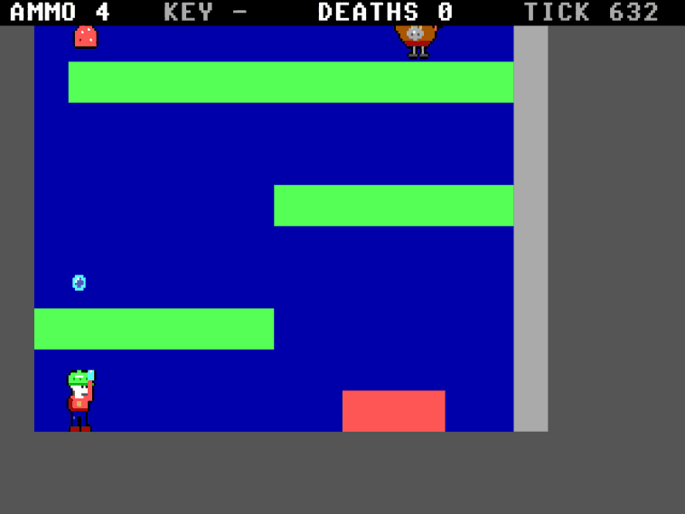  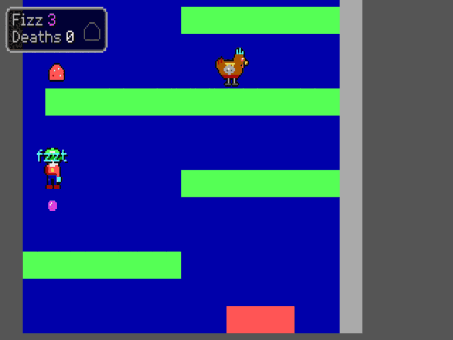

*DOS build, same set-up. Left: Up and Fizz together fire straight up (`Fizz` 4 in the HUD). Right: Down and Fizz together in mid-jump fire straight down.*

### The red key and the door

Walk onto the red key to pick it up; the key chip in the HUD fills in. Carry it to the red door and walk into it: the door opens and the key is used up. The door stays open for the rest of the run, even if you die afterwards. If you die while still carrying the key, it goes back to where it lay.

### The snack nook

The gallery at the top is also a small playground, where the things Ben can do each have a place to happen. The exit is behind a blue door under a ceiling of blocks, so you have to go through the nook to reach it. Walk onto the gallery's right end and you will see a shelf of grey blocks four tiles up, with snacks on top of it and two cheezies hanging underneath.

- **Snacks.** Cheezies are worth 1 point, a chocolate bar 2 and a cookie 5 (Fizz 1's points). Walking into one takes it. The score is worked out in the rules but not drawn yet. If you die, the snacks come back.
- **Bumping your head.** Jump straight up under the shelf. You take the cheezie, and your head hits the shelf, which counts as a head bump (it happens once for each jump).
- **Bouncing.** The shelf is too high to jump onto. Get on the pogo stick next to the right-hand wall, bounce a couple of times, then hold Jump as you land for the high bounce and steer left at the top: you land on the shelf and keep bouncing along it, collecting the cheezie, the chocolate bar, the cookie and the blue key at the left end.
- **The blue door.** Drop off the left end of the shelf facing the blue door with the blue key. The door opens and the key is used up, just like the red one. The way to the exit is through it.
- **An empty blaster.** You start with five Fizz shots. After the fifth, pressing Fizz again does nothing but make the "no Fizz" click that Fizz 1 has.

The Web page and the DOS build show all of these as pictures, with their words (see [Captions](#captions)) and their sounds (see [Sound effects](#sound-effects)). The key chip in the HUD is the red key's only; the blue key has no chip.

### The chicken

The chicken walks to and fro along its ledge and turns round at walls and edges. Touching it from the side or below kills you. You can deal with it two ways. Land on it from above, with or without the pogo stick, and it is stunned for three seconds and you bounce off it, higher on the stick. Or hit it with a Fizz shot and it is stunned for six seconds. A stunned chicken lies flattened and harmless and flashes for its last second before it wakes; two little yellow-and-white stars (Fizz 1's) twinkle above its head while it is stunned (the screenshot below is from the Web build). It looks like a brown chicken with a crest; the artwork is a stand-in for the real enemy. Every one and a half to six seconds, chosen at random, it clucks: its beak opens and a word floats above it (see [Captions](#captions)).

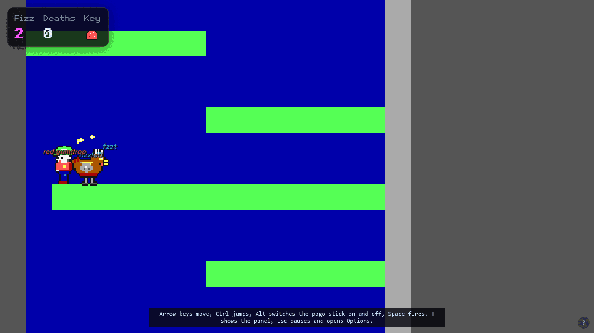

*The Web build (commit 796602d), 1280 by 720, tick 300 of the replay: the chicken was hit by a Fizz shot and is stunned; its stars twinkle above it. DOS draws the stars too.*

### Death and respawn on DOS

Spikes, the chicken, and falling out of the bottom of the map all kill you. Ben tumbles through the air, spinning head over heels as he falls (about one and a quarter turns a second, as in Lieutenant Fizz 1), for a moment, then you start again at the beginning of the level, about a second and a half later, with five shots, the chicken back at its start and the key back where it lay if you were carrying it. The `DEATHS` count goes up. An open door stays open. The screen shakes sideways for a third of a second when you die, as in Lieutenant Fizz 1; a small shake, a pixel or so either way. The Motion row of the DOS Options screen turns both off (Reduced): Ben's fall is then flat and the screen stays still.

## The Web slice

The Web page plays the first slice of Episode 2. You are Ben, climbing the inside of a lighthouse. Fetch the red key, open the red door with it, climb the second shaft and walk into the exit. The chicken clucks now and then (see [Sound on the Web](#sound-on-the-web)), and the page shows the level in a window that scrolls with you. The window is always 13 tiles tall, and a wider browser window shows more of the level to the sides, as in Fizz 1 (the DOS version keeps its fixed 320 by 200 picture).


*The Web build (commit 796602d), headless Chromium at 1280 by 720: Ben has just fired a shot at tick 40, so the HUD's `Fizz` reads 4. The HUD sits in the top left corner of the picture and the debug lines are in the panel shown below.*

### The level on the Web

The level is a tall room split into a left shaft and a right shaft by a wall. You start on the floor of the left shaft. Green ledges climb it in steps you can only clear with a full jump, one ledge on the left, the next on the right, so you cross the shaft each time. You can jump up through a ledge from below and land on it from above.

- **The chicken** walks the long third ledge. It is a placeholder for the real art. Touching it from the side or from below kills you. Landing on its head from above stuns it for three seconds and bounces you. A Fizz Blaster shot stuns it for six seconds. While it is stunned you can walk through it.
- **The red key** lies at the far left end of that ledge. Walk over it to pick it up. The `KEY` line reads `carried` while you have it.
- **The spikes** on the ground floor kill you if you land or walk on them. So does falling out of the bottom of the level.
- **The red door** is in the wall between the shafts, high up. Walk into it while carrying the key and it opens and the key is used up. `DOOR` reads `open`. An open door stays open for good, even if you die later.
- **The exit** is in a gallery at the top of the right shaft. Reaching it sets `EXIT` to `reached` and stops you in place. Press Restart to play again.

### Moving, jumping, the pogo stick and the blaster

- **Walking:** left and right. You turn to face the way you last pressed.
- **Looking:** stand still on the ground and hold Up or Down by itself to look up or down; the view slides 3.6 tiles that way after a short pause, and slides back when you let go, unless the level's edge stops it. The arrows do it in both layouts, and `W` and `S` do it in the Modern layout. It does nothing while you walk, jump or ride the pogo stick.
- **Jumping:** press Jump to leave the ground. Let go early for a shorter hop; hold it for the full height.
- **The pogo stick:** the Pogo key switches it on and off. While it is on, you bounce by yourself instead of standing, and Jump stops making a leap: hold it instead to make each bounce much higher. Switch the stick off before you climb with ordinary jumps.
- **The Fizz Blaster:** Fire shoots straight ahead. Hold Up while you fire to shoot straight up, or hold Down in the air to shoot straight down (Down on the ground still fires ahead). Ben shows a matching pose for a moment after each shot. You start with five shots, `AMMO` counts the rest, and shots fly about a second and stop on walls. You get your five back after a death.

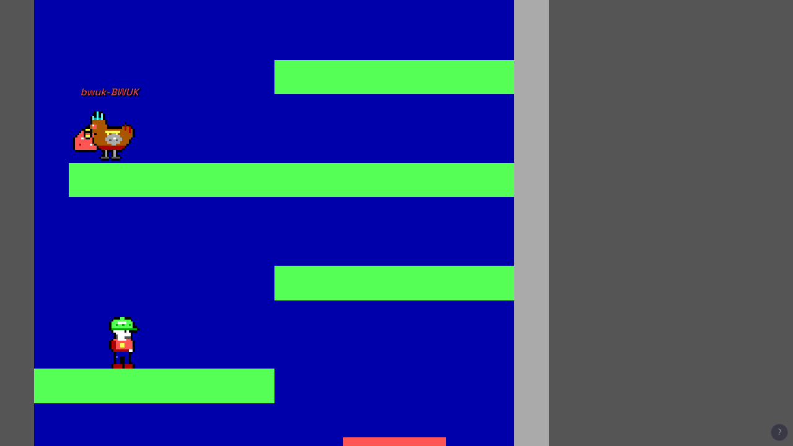

*The Web build (commit 796602d), 1280 by 720, tick 210: after the first 150 ticks of the replay Ben stands on the first ledge and holds Up for 60 ticks; the chicken clucked at tick 197.*

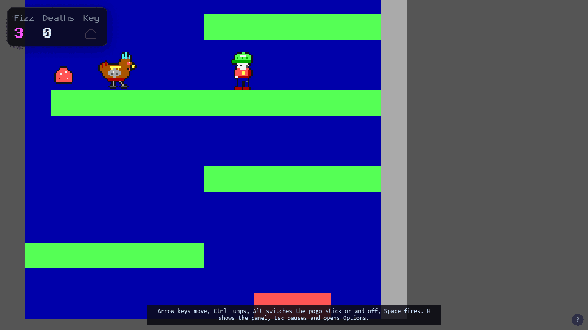

*The Web build (commit 796602d), 1280 by 720, tick 326: after the first 236 ticks of the replay Ben stands on the chicken's ledge (the third) and holds Down for 90 ticks. The view slides down as far as the foot of the level allows, which is about half a tile past the spikes, so the picture ends in a thin grey strip. On the first ledge the view cannot slide down because the level ends just below it.*

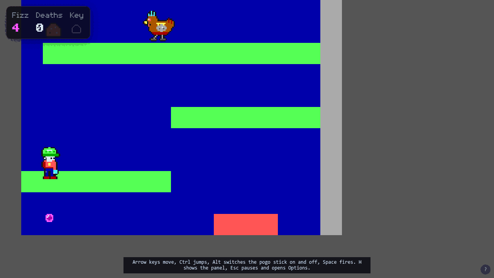

*The Web build (commit 796602d), same window, tick 41: Down and Fire together in a jump fire straight down, so `Fizz` in the HUD reads 4.*

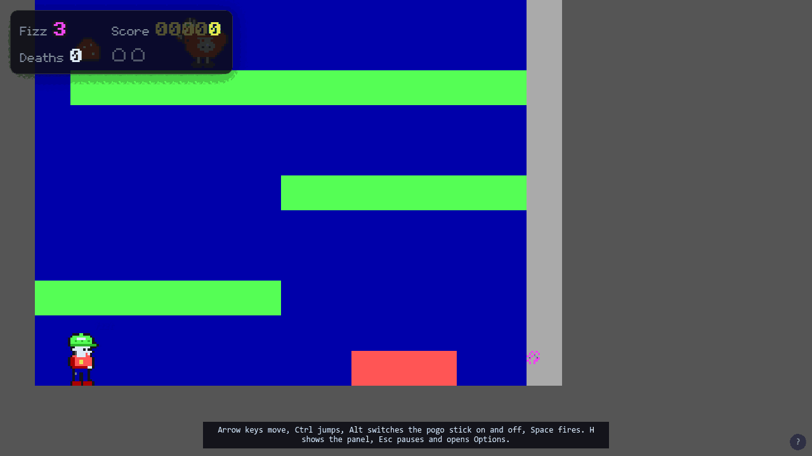

*The Web build (commit 796602d), same window, tick 108: the second shot of the replay has just hit the wall, two ticks earlier, and pops as a small light magenta puff (the Fizz colour) that swells and thins out for a third of a second. DOS draws the same puff.*

The keys for each action are in the table under Controls, in both the Keen and the Modern layouts. Switching layouts lets go of every key you are holding.

### Death and respawn on the Web

You die on spikes, on a chicken that is not stunned, and by falling out of the bottom. Ben falls over for about a second and a half, then starts again at the bottom of the left shaft with five shots. `DEATHS` counts how many times this has happened. A key you were carrying goes back to where it first lay, unless the door is already open, in which case it is gone. The chicken starts again as well. The screen gives a small sideways shake for a third of a second when Ben dies, and Ben spins as he falls. The Motion row of the Options screen chooses Full, Reduced or System (follow your device's setting); Reduced keeps the screen still and Ben's fall flat, in the flickering pose without the spin. Until you choose, Motion is System, which follows your device's reduced-motion setting (Reduced if it asks for less motion), and after you choose it remembers your choice on this browser, if the browser allows it to. The shake and the spin change only the picture, never what happens in the game.

### The Web heads-up text

The page is the game: the picture fills the whole window and nothing scrolls. It is always 13 tiles tall and as wide as the window's shape allows, so a phone held upright shows about six tiles across and an ultra-wide monitor shows the whole width of the level with sky at the sides. The picture is scaled to the window's height, in a whole-number multiple when the height is one of 208, 416, 624 and so on, and by a fraction otherwise (the pixels are then slightly uneven). Past about 80 tiles wide the picture stops growing and dark bars fill the rest. Resizing or turning the device resizes the picture after a moment; the game itself is not affected, and the fingerprint is the same at every window size. Over the picture, in the top left corner, a small dark HUD in Fizz 1's pixel lettering shows what you need while you play: `Fizz`, how many Fizz shots you have left (the number is light magenta, the grape colour of Fizz in this game, and turns red at zero), `Deaths`, how many times you have died, and `Key`, which shows the red key when you carry it and a dim outline of it when you do not. Numbers stop at 99. The HUD grows with the window as Fizz 1's does (three sizes, by the window's height), cannot be clicked, does not move or animate, and keeps out of Ben's way: if he comes near the corner it moves to the opposite top corner. A screen reader is not read the HUD each frame; it hears one short line when the Fizz runs out ("Out of Fizz"), when you pick up the key ("Red key picked up") and when you die ("Deaths 1"), and nothing else. `TICK` and `HASH` are not in the HUD; they, and the other debug lines, stay in the panel. A hint shows for a few seconds after the page loads. Everything else is in a panel that you show and hide with `H` or the small `?` button in the bottom right corner (Esc has its own job: it pauses the game and opens the Options screen, described next). In the panel, seven lines of text show how the run is going: `TICK` (60 a second), `HASH` (a 16-digit fingerprint of everything that has happened so far; two copies given the same moves show the same one), `AMMO`, `KEY`, `DOOR`, `DEATHS` and `EXIT`. The panel also has a goal line that says what to do, the keys line for the layout in use, and an `Options (Esc)` button that opens the Options screen. The settings used to be buttons in the panel; they are rows of the Options screen now. Restart is on the Paused screen and starts the level again from the first tick; it does not reload the page.

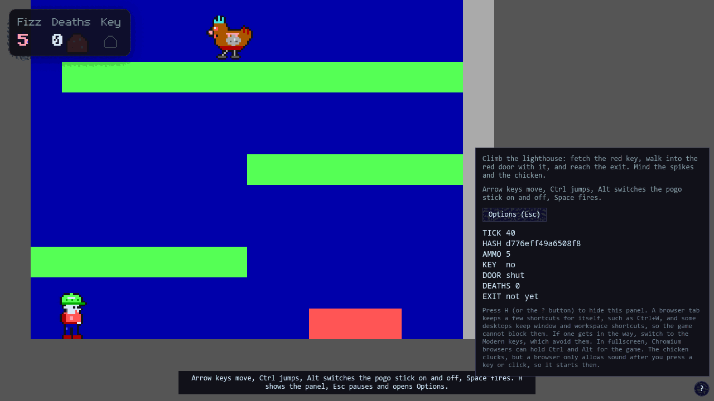

*The Web build (commit 796602d), 1280 by 720, tick 40, after pressing `H`. Press `H` again, or the round button in the corner, to hide the panel. The settings are rows of the Options screen; the panel's one button, `Options (Esc)`, opens it.*

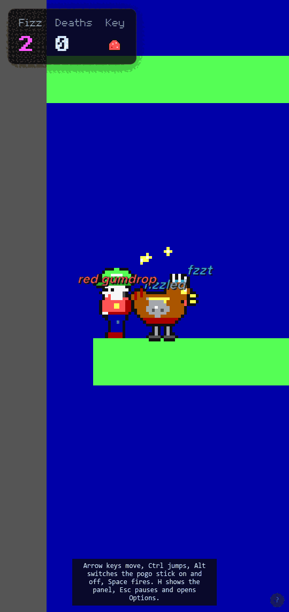

*The Web build (commit 796602d), headless Chromium with a 540 by 1140 window, tick 300 of the replay. The picture is 13 tiles tall as always and only about six tiles wide, centred on Ben.*

### Options on the Web

Press `Esc` (or the Pause key) and the game stops. A dark panel opens over the picture with three rows: Resume, Options and Restart. Move with Up and Down, choose with Enter, Space or the mouse, and press `Esc` again to resume. Restart starts the level again from the first tick, and Options opens the settings. The game is held for as long as either screen is up: nothing moves, the tick stops, and when you resume it carries on from where it stopped, with no catching up. The `Options (Esc)` button in the `H` panel opens the settings directly, and Back from there goes back to the game. In fullscreen the browser uses the first `Esc` to leave fullscreen; press `Esc` or the Pause key again to pause.

The selected row is a bright light magenta plate (the grape colour of Fizz 2) that shimmers through three shades, with a can of fizzy drink bobbing beside it; Fizz 1's menus look the same in amber. On a row you can change, the selected row shows `◄ value ►`; Left steps back one choice, Right, Enter and Space step forward, and the choices wrap round. With the mouse, hovering a row selects it, clicking steps it, and clicking the arrows steps it the way the arrow points. A change takes effect at once and is remembered. The rows are:

| Row | Choices | What it does |
| --- | --- | --- |
| Sound | On, Off | All sound, the same as `M` |
| Music | On, Off | The tune only; the sound effects stay |
| Placement | Enhanced, Classic | Whether a sound is panned and softened by where it happens |
| Motion | System, Reduced, Full | The shake and spin when Ben dies; System follows your device's setting |
| Captions | On, Off | The words where things happen, the same as `V`; the sounds stay |
| Keys | Keen, Modern | Which set of keys you play with |
| Fullscreen | Off, On | The same as `F`; it is left out where the browser cannot go fullscreen |
| Back | | Goes back one screen |

`Esc` goes back one screen from Options, so it takes you to Paused, and again to the game. If you start with `?audio=classic` or `?audio=enhanced` at the end of the address, the Placement row shows a `*` and a line under the rows says it was set by the address and that changing it applies to this visit; change the row and the star goes. The page keeps all of your choices on this browser, if the browser allows it to, and reads the settings saved by older versions of the page the first time. If the setting for reduced motion is on, or Motion is Reduced, the plate and the can hold still. A screen reader is told the screen's name, then each row and its value as you move, and each change as you make it. Nobody has used the screens with a screen reader or in a real browser yet.

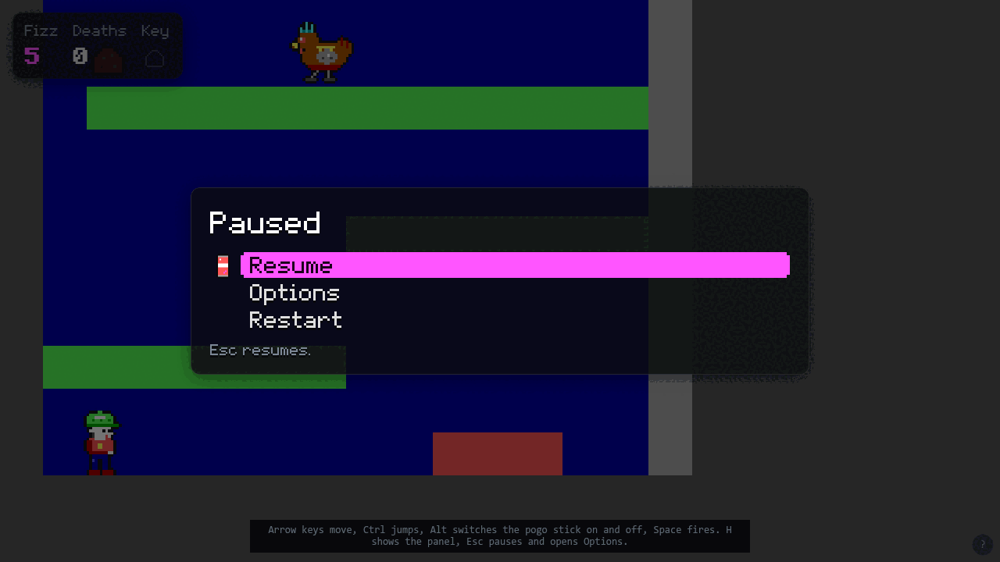
*The Web build (commit 796602d), headless Chromium at 1280 by 720, 40 ticks after load and Esc pressed: Paused with Resume chosen.*

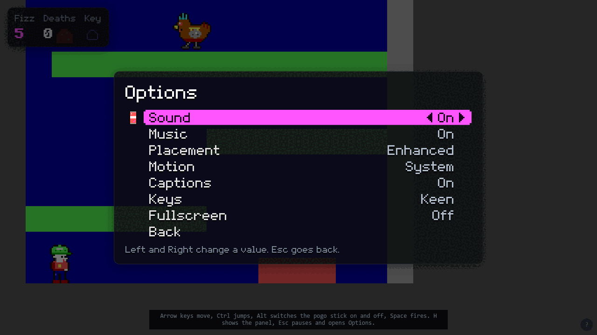

*The Web build (commit 796602d), headless Chromium at 1280 by 720, 40 ticks after load and Esc, Down and Enter pressed: Options with Sound selected.*

### Sound on the Web

The chicken clucks at random, between one and a half and six seconds apart, while it is awake, in one of four ways: a low "buh" followed by a loud falling "gawk", a short single cluck, a quick double cluck, and "cluck, cluck". A stunned chicken is quiet. The other sounds (shots, snacks, keys, doors, jumps and the rest; see [Sound effects](#sound-effects)) play when they happen. There is one tune, described under Music below.

A browser does not let a page make sound until you have pressed a key or clicked on it, so you hear nothing until your first key press; sounds before then are not played later. Press `M`, or use the Sound row of the Options screen, to turn the sound off and on. The row shows which it is, and the page remembers your choice on this browser, if the browser allows it to. `M` mutes everything, the music as well as the clucks, and does nothing else in either set of keys. The page is silent while its tab is hidden, and when more than six sounds are playing at once the extra ones are dropped so that the sound does not distort (`whoa!` and `ta-da!` are never dropped). A sound comes from the side of the screen it happens on, as described under [Where a cluck comes from](#where-a-cluck-comes-from), and the Placement row of the Options screen chooses Enhanced or Classic.

**Music.** The Web page plays a looping song called Crater Fields, from the moment of your first key press or click. It is Lieutenant Fizz 1's level song, used here as a placeholder to test the music, and it is not an official Episode 2 track; it will be replaced. It runs about a minute, then goes straight back to the start, and keeps playing when Ben dies, comes back or reaches the exit. The Music row of the Options screen turns just the music off and on (the sound effects stay); the page remembers the choice on this browser, and music is on until you turn it off. A muted page plays no music either, and turning it on again starts the song from the beginning. The song is quieter than the sound effects on purpose. Music is not part of the game: it never changes what happens or the `HASH`. DOS plays the same song with an AdLib or a Sound Blaster (see [Hearing the cluck on DOS](#hearing-the-cluck-on-dos)). Nobody has listened to the Web music in a real browser.

## The screen

Both versions draw the same level with the same camera that follows Ben as he moves through it; the DOS version in a fixed 320 by 200 window, the Web version in a window as wide as the browser's. The DOS version draws a small box of `Fizz`, `Deaths` and the key chip in the top-left corner of the picture and prints the final `TICK` and `HASH` when a run ends; the Web version shows them as lines of text in the panel (`H`).

- `TICK` counts game steps. There are 60 a second.
- `HASH` is a 16-digit fingerprint of everything that has happened so far. Two copies that were given the same moves show the same fingerprint, on any platform.


## Web and DOS compared

The two versions run the same rules engine and draw the same slice with the same picture routine, so the same moves give the same `TICK` and `HASH` on both.

- **Same:** the level, the colours, the moves, the two sets of keys, the 60-steps-a-second pace, the `TICK` and `HASH` values, the sound effects and the placeholder song. The sound is made differently on each (see [Hearing the cluck on DOS](#hearing-the-cluck-on-dos) and [Sound on the Web](#sound-on-the-web)), and both place each sound by where it happens on the screen (see [Where a cluck comes from](#where-a-cluck-comes-from)). The song is Fizz 1's Crater Fields, used as a placeholder; on DOS it plays on an AdLib or a Sound Blaster, never on the PC speaker.
- **Different:** the DOS version opens its Paused menu and Options screen with Esc (it ends a run through Quit to DOS), the modes and switches listed under [DOS modes](#dos-modes) (`/LIVE`, `/REPLAY`, `/BENCH`, `/PROBE` and `/PANIC`, with `/MODERN`, `/KEEN`, `/NOCAPTIONS` and the frame-rate switches as switches) and a 30-second wall-clock limit in `/LIVE`; the Web version has Paused and Options screens (Esc or the Pause key), a panel with a goal line, and runs for as long as the page is open. The Web version fills a browser window of any size; the DOS version fills a 320 by 200 VGA screen.

## Coming

Episode 2 is planned to bring more sound: designed effects and the real music (the placeholder song and the first-draft effects stand in for them); an overworld, an inner world and an underworld; more levels with keycards and doors; new gadgets beyond the pogo stick; new enemies; a lighthouse level; saves; and a title screen. None of this is in the builds yet.
