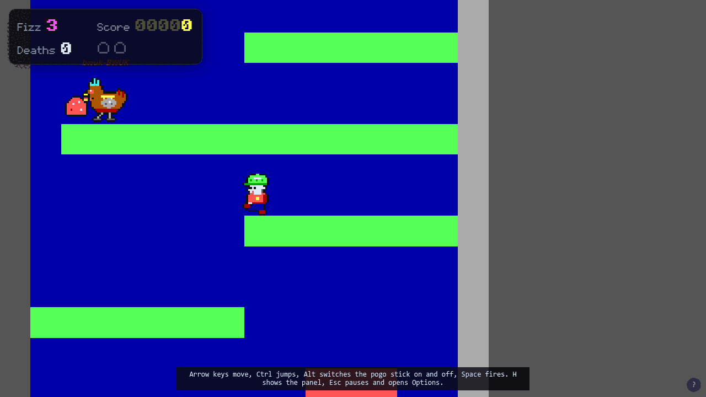
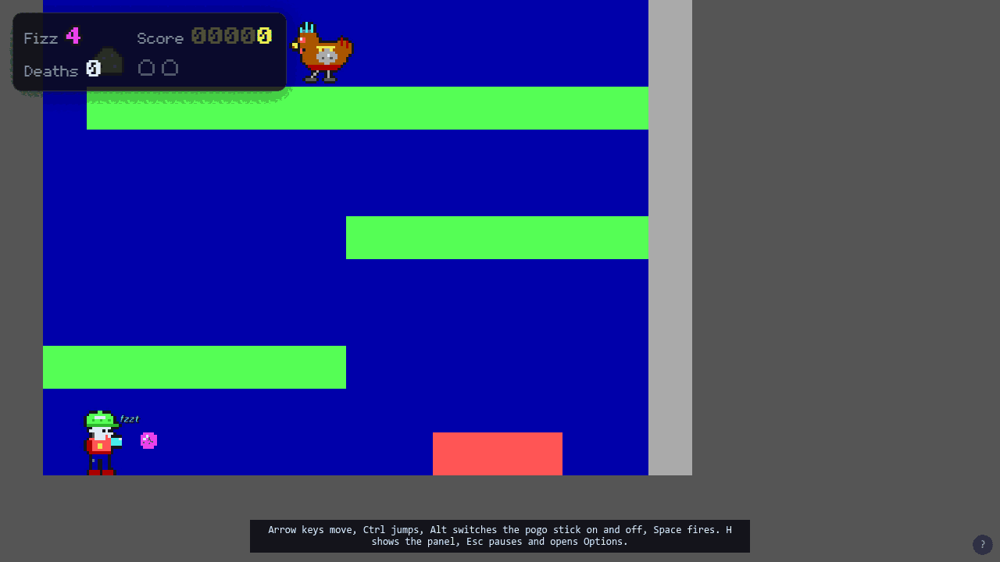

# Lieutenant Fizz 2 — Player's Manual

This manual is updated with every change a player can see or do, in the same pull request as the change. It describes the builds as they are today, not as they are planned. The rule is in the "Game Manual" section of [`AGENTS.md`](../AGENTS.md).

## What this is

Lieutenant Fizz 2 is a technical preview. Both the Web and the DOS versions play the first slice of the game: one small vertical maze with a red key, a red door, a chicken and an exit, using the pogo stick, the jump and the Fizz Blaster from Lieutenant Fizz 1 (see [The slice on DOS](#the-slice-on-dos) and [The Web slice](#the-web-slice)). There is no story and no menu, and only the Web version makes sound so far: the chicken's cluck. The two versions exist to prove that the game behaves identically on both.

## Running it

### Web

Build the page with `tools/build-web.sh`, then serve the `dist/web` folder with any static file server and open it in a browser. The build needs the Rust toolchain from the repository and a matching `wasm-bindgen` command-line tool; [`PLATFORM.md`](PLATFORM.md) has the exact version.

### DOS

Build the program with `tools/build-dos.sh`, which writes `FIZZ2.EXE` and `CWSDPMI.EXE` into `dist/dos`. Keep the two files together and run `FIZZ2.EXE` in DOSBox or js-dos. It needs a VGA display, and it targets a 486-class PC. The build needs the DOS toolchain described in [`PLATFORM.md`](PLATFORM.md); you do not need a C compiler.

## Controls

There are two sets of keys, and you use one at a time. Keen is the default on the Web and on DOS.

| Action | Keen keys (default) | Modern keys |
| --- | --- | --- |
| Move | Arrow keys | Arrow keys or `W` `A` `S` `D` |
| Jump | Ctrl | `Z` |
| Pogo stick | Alt | `X` |
| Fizz (fire) | Space | `C` or Space |
| Quit | Esc (DOS only) | Esc (DOS only) |
| Fullscreen | `F` (Web only) | `F` (Web only) |
| Sound on or off | `M` (Web only) | `M` (Web only) |
| Captions on or off | `V` (Web only) | `V` (Web only) |

In the slice every key in the table does something; [The slice on DOS](#the-slice-on-dos) and [The Web slice](#the-web-slice) say what, and the two versions use the same keys for the same actions. Keys from the other set do nothing, so `W` does not move you under the Keen keys.

On the Web there is no quit key; close the tab.

### Choosing your keys

- **Web:** the Keys button under the screen switches between Keen and Modern, and the line above it lists the keys in use. The page remembers your choice on this browser, if the browser allows it to.
- **DOS:** start with `FIZZ2.EXE /MODERN` for the Modern keys. Without it you get the Keen keys.

### Captions

When the chicken clucks, its beak opens and its words float above its head for about a second, rising a little and fading, as the sound words do in Lieutenant Fizz 1. The words depend on the cluck: `buh-gawk!`, `bwuk`, `bwuk-bwuk` or `bwuk, bwuk` (on the Web they are lower-case text over the picture, as in Lieutenant Fizz 1; the DOS screen font has only capital letters, so there they show as capitals), each in its own colour. The double clucks open the beak twice. The words stay with the chicken, so as it walks off the edge of the picture its words are cut off by the edge with it, and they are left out once it is more than a tile outside the picture. There is no sound yet, so these are the only sign that the chicken has clucked.

*The Web build, captured in headless Chromium at tick 202, five ticks after the chicken's first cluck.*

- **Web:** the Captions button under the screen turns them on and off, and so does `V`. They are on until you turn them off, and the page remembers your choice on this browser, if the browser allows it to.
- **DOS:** start with `FIZZ2.EXE /NOCAPTIONS` to turn them off, or `/CAPTIONS` for on, which is the default. It combines with the other options, as in `FIZZ2.EXE /MODERN /NOCAPTIONS`. A choice kept between runs comes with the settings screen, later.

Turning captions off hides only the words; the beak still opens.

### Fullscreen and browser shortcuts

On the Web, press `F` or use the Fullscreen button to fill the screen, and press it again to leave. A web page cannot stop a browser tab from acting on a few shortcuts: Ctrl+W closes the tab whatever the game does, and some desktops keep their own window and workspace shortcuts. In fullscreen, Chromium-based browsers (Chrome, Edge and similar) let the game keep Ctrl, Alt and the other game keys to itself; other browsers do not. If a shortcut keeps getting in your way, switch to the Modern keys, which do not use Ctrl or Alt.

### DOS modes

Add one of these after the program name, such as `FIZZ2.EXE /REPLAY`. With no mode, you get `/LIVE`. Add `/MODERN` as well, or by itself, to use the Modern keys in `/LIVE`, as in `FIZZ2.EXE /MODERN`. `/NOCAPTIONS` and `/CAPTIONS` work the same way; see [Captions](#captions).

- `/LIVE` — you play the slice. It ends when you press Esc, or by itself after 30 seconds, and then prints the final tick, the hash, and whether Ben moved from where he started.
- `/REPLAY` — plays a built-in run through the whole slice by itself, with no keyboard input: about 21 seconds in which Ben shoots and stomps the chicken, dies once on the spikes, takes the key, opens the door and walks into the exit. It then prints the list of hashes it reached and a few lines about the machine, including `EXIT yes` when Ben got out. Use it to check that your copy agrees with the Web version, and to watch the level without playing it.
- `/BENCH` — times your computer. It plays the same built-in run as fast as it can, with no waiting, and then prints how many microseconds each picture took for the game's rules, the drawing and the copy to the screen, next to the 16,667 microseconds that one tick at 60 a second allows. If the drawing figure is much larger than that, the game will run slower than 60 pictures a second on your machine. It also prints a line that times a short fixed loop of simple steps, which shows how fast your computer ran the test. It does not wait between pictures, so it is usually over sooner than `/REPLAY`, and it ends with `EXIT yes` when Ben got out. Add a number, as in `/BENCH 120`, to time only that many pictures from the start of the run; it is quicker, and it does not reach the exit.
- `/PROBE` — looks at your computer and tells you what it found, without playing or drawing anything and without waiting for a key. It prints one line each for your screen (`vga`, `ega`, `cga` or a monochrome adapter), whether a mouse and a joystick are connected, what kind of music chip you have (`none`, `opl2`, `dualopl2` or `opl3`), your Sound Blaster (`none`, or its version and port), the `BLASTER` setting, whether you have a maths chip, your processor (`386`, `486` or `586` for a Pentium or later) and how much memory is free. It also prints a code for the start-up screen the game will show for your computer and how much memory the program holds, and ends with `EXIT yes`. Use it to see how the game sees your computer; the start-up screen and the sound that use these results come later.
- `/PANIC` — makes the program stop on purpose, to show that it puts the keyboard, timer and screen mode back as it found them. It is a test, and it exits with status 3.

## The slice on DOS

*Screenshot of the DOS build with the slice, `FIZZ2.EXE /REPLAY` in DOSBox Staging, at tick 249 of the built-in run. The emulator scales the 320 by 200 picture up.*

You are Ben, in a cut-down lighthouse of 32 tiles by 48. The screen follows you up and down and left and right. There is no sound.

When you play with `/LIVE`, the DOS version waits for the screen to finish drawing before it shows each new picture, which keeps the picture from tearing. Nothing else about how it plays changes.

The strip along the top is the HUD. `AMMO` is how many Fizz shots you have left, `KEY` shows `RED` while you carry the red key, `DEATHS` counts how many times you have died, and `TICK` counts game steps, 60 a second.

### The level on DOS

You start on the floor of the left shaft, with spikes a few steps to your right. The shaft climbs by ledges of one-way platforms, bright green on the screen, which you can jump up through and land on from above. A chicken walks the long third ledge, and the red key lies at its far left end. Above that the ledges lead up to the red door, a brown door in the wall that divides the two shafts. Through the door a second shaft climbs again to a gallery in the open air, where a yellow exit stands. Touching the exit ends the level: the game shows `LEVEL CLEAR` and Ben stops.

Tiles are told apart by colour: dark blue is the wall behind the rooms, dark grey and light grey are solid blocks you cannot pass, bright green is a one-way platform, bright red is spikes, brown is the red door and yellow is the exit.

### Moves

- **Walk and run:** the left and right arrows. Ben speeds up and slows down rather than stopping at once.
- **Look:** stand still on the ground and hold Up or Down by itself. After a fifth of a second Ben looks up or down, and over about a third of a second more the screen slides to show 3.6 tiles higher or lower than usual. Let go and the view slides back in a third of a second. It works with the arrow keys in both layouts, and with `W` and `S` in the Modern layout; it does nothing while you are walking, in the air, on the pogo stick or holding Up and Down together. It is the same on DOS and on the Web.
- **Jump:** press Jump. A full jump rises a little over three tiles, enough to climb from one ledge to the next. Let go of Jump early to cut the jump short.
- **Pogo stick:** press Pogo to get on the stick and press it again to get off. On the stick Ben bounces by himself and you steer him in the air with the arrows; he cannot walk. Hold Jump as he lands for a much higher bounce. He squashes for a moment at the bottom of each bounce.
- **Fizz:** press Fizz to fire a bubble of fizz from the Fizz Blaster in the way Ben faces. Hold Up while you press it to fire straight up (even standing still), or Down while Ben is in the air to fire straight down; Down on the ground fires ahead. Ben shows a matching pose for a moment after each shot. You have five shots, and a shot that hits a wall or flies about a second just pops. You get all five back after you die.

### The red key and the door

Walk onto the red key to pick it up; the `KEY` in the HUD turns red. Carry it to the red door and walk into it: the door opens and the key is used up. The door stays open for the rest of the run, even if you die afterwards. If you die while still carrying the key, it goes back to where it lay.

### The chicken

The chicken walks to and fro along its ledge and turns round at walls and edges. Touching it from the side or below kills you. You can deal with it two ways. Land on it from above, with or without the pogo stick, and it is stunned for three seconds and you bounce off it, higher on the stick. Or hit it with a Fizz shot and it is stunned for six seconds. A stunned chicken lies flattened and harmless and flashes for its last second before it wakes. It looks like a brown chicken with a crest; the artwork is a stand-in for the real enemy. Every few seconds it clucks: its beak opens and a word floats above it (see [Captions](#captions)).

### Death and respawn on DOS

Spikes, the chicken, and falling out of the bottom of the map all kill you. Ben tumbles through the air for a moment, then you start again at the beginning of the level, a second and a half later, with five shots, the chicken back at its start and the key back where it lay if you were carrying it. The `DEATHS` count goes up. An open door stays open.

## The Web slice

The Web page plays the first slice of Episode 2. You are Ben, climbing the inside of a lighthouse. Fetch the red key, open the red door with it, climb the second shaft and walk into the exit. The chicken clucks now and then (see [Sound on the Web](#sound-on-the-web)), and the page shows the level in a fixed 320 by 200 window that scrolls with you.

*The Web build, captured in headless Chromium: Ben has just fired a shot, so `AMMO` reads 4.*

### The level on the Web

The level is a tall room split into a left shaft and a right shaft by a wall. You start on the floor of the left shaft. Green ledges climb it in steps you can only clear with a full jump, one ledge on the left, the next on the right, so you cross the shaft each time. You can jump up through a ledge from below and land on it from above.

- **The chicken** walks the long third ledge. It is a placeholder for the real art. Touching it from the side or from below kills you. Landing on its head from above stuns it for three seconds and bounces you. A Fizz Blaster shot stuns it for six seconds. While it is stunned you can walk through it.
- **The red key** lies at the far left end of that ledge. Walk over it to pick it up. The `KEY` line reads `carried` while you have it.
- **The spikes** on the ground floor kill you if you land or walk on them. So does falling out of the bottom of the level.
- **The red door** is in the wall between the shafts, high up. Walk into it while carrying the key and it opens and the key is used up. `DOOR` reads `open`. An open door stays open for good, even if you die later.
- **The exit** is in a gallery at the top of the right shaft. Reaching it sets `EXIT` to `reached` and stops you in place. Press Restart to play again.

### Moving, jumping, the pogo stick and the blaster

- **Walking:** left and right. You turn to face the way you last pressed.
- **Looking:** stand still on the ground and hold Up or Down by itself to look up or down; the view slides 3.6 tiles that way after a short pause, and slides back when you let go. The arrows do it in both layouts, and `W` and `S` do it in the Modern layout. It does nothing while you walk, jump or ride the pogo stick.
- **Jumping:** press Jump to leave the ground. Let go early for a shorter hop; hold it for the full height.
- **The pogo stick:** the Pogo key switches it on and off. While it is on, you bounce by yourself instead of standing, and Jump stops making a leap: hold it instead to make each bounce much higher. Switch the stick off before you climb with ordinary jumps.
- **The Fizz Blaster:** Fire shoots straight ahead. Hold Up while you fire to shoot straight up, or hold Down in the air to shoot straight down (Down on the ground still fires ahead). Ben shows a matching pose for a moment after each shot. You start with five shots, `AMMO` counts the rest, and shots fly about a second and stop on walls. You get your five back after a death.

The keys for each action are in the table under Controls, in both the Keen and the Modern layouts. Switching layouts lets go of every key you are holding.

### Death and respawn on the Web

You die on spikes, on a chicken that is not stunned, and by falling out of the bottom. Ben falls over for about a second and a half, then starts again at the bottom of the left shaft with five shots. `DEATHS` counts how many times this has happened. A key you were carrying goes back to where it first lay, unless the door is already open, in which case it is gone. The chicken starts again as well.

### The Web heads-up text

Under the screen, seven lines of text show how the run is going: `TICK` (60 a second), `HASH` (a 16-digit fingerprint of everything that has happened so far; two copies given the same moves show the same one), `AMMO`, `KEY`, `DOOR`, `DEATHS` and `EXIT`. Below that, a goal line says what to do, the keys line shows the keys of the layout in use, and the Keys, Captions, Restart, Fullscreen and Sound buttons sit beneath it. Restart starts the level again from the first tick; it does not reload the page.

### Sound on the Web

The chicken clucks every couple of seconds or so (the gap is random) while it is awake, in one of four ways: a low "buh" followed by a loud falling "gawk", a short single cluck, a quick double cluck, and "cluck, cluck". A stunned chicken is quiet. There is no other sound yet, and no music.

A browser does not let a page make sound until you have pressed a key or clicked on it, so you hear nothing until your first key press; clucks before then are not played later. Press `M`, or click the Sound button under the screen, to turn the sound off and on. The button shows which it is, and the page remembers your choice on this browser, if the browser allows it to. `M` does nothing else in either set of keys. The page is silent while its tab is hidden, and when several chickens cluck at once the extra clucks are dropped so that the sound does not distort. The sound is centred; it does not yet come from the side the chicken is on.

## The screen

Both versions draw the same picture, a 320 by 200 window that follows Ben as he moves through the level. The DOS version draws its strip of `AMMO`, `KEY`, `DEATHS` and `TICK` along the top of the picture and prints the final `TICK` and `HASH` when a run ends; the Web version shows them as lines of text under the picture.

- `TICK` counts game steps. There are 60 a second.
- `HASH` is a 16-digit fingerprint of everything that has happened so far. Two copies that were given the same moves show the same fingerprint, on any platform.

## Web and DOS compared

The two versions run the same rules engine and draw the same slice with the same picture routine, so the same moves give the same `TICK` and `HASH` on both.

- **Same:** the level, the colours, the moves, the two sets of keys, the 60-steps-a-second pace and the `TICK` and `HASH` values. Only the Web version makes sound for now.
- **Different:** the DOS version has an Esc key, four modes (`/LIVE`, `/MODERN`, `/REPLAY` and `/BENCH`), the `/NOCAPTIONS` switch and a 30-second limit in `/LIVE`; the Web version has Keys, Captions, Restart, Fullscreen and Sound buttons, the chicken's cluck (the DOS version is silent for now), a goal line, and runs for as long as the page is open. The Web version runs in a browser window of any size; the DOS version fills a 320 by 200 VGA screen.

## Coming

Episode 2 is planned to bring more sound: the cluck on DOS, then other effects and music; an overworld, an inner world and an underworld; more levels with keycards and doors; new gadgets beyond the pogo stick; new enemies; a lighthouse level; saves; and menus. None of this is in the builds yet.
