# Sound

This document is the sound story of Lieutenant Fizz 2: what plays on each platform, how the first effect (the chicken's cluck) is made and placed, and how music fits in. The Web leads on fidelity and DOS on budgets, so the Web plays rich Undertone sources and DOS plays downmixes of them.

## Overview

What plays where, today:

| Platform | Effects (the cluck) | Music |
| --- | --- | --- |
| Web | The rich Undertone source, placed by the chicken's position (Enhanced) or centred (Classic) | The rich Undertone song, built (see [MUSIC.md](MUSIC.md)) |
| DOS, OPL2 or AdLib | The OPL2 chunk on channel 5, with the distance as a carrier level and no pan | Planned, on channels 0 to 4 and 6 to 8 |
| DOS, OPL3 or Sound Blaster | The OPL3 pair: channel 5 is the left side and channel 14 (bank 1) the right, each at its own level. With effects set to AdLib, channel 5 alone, in both speakers | Planned, on the 13 channels `[0, 1, 2, 3, 4, 9, 10, 11, 12, 13, 15, 16, 17]` |
| DOS, PC speaker | The speaker list, with no placement | None |

Two rules hold on every path. Channel 5 is the default effects channel everywhere, and channel 14 is its right extension on an OPL3, so music never uses either. Positional sound is view-only: the rules never see it, so it cannot change a hash or a replay.

Every effect has one definition, as a rich Undertone effect, and a script derives the DOS data from it. The effect id is the one number that names an effect on every path: entry `id` of `EFFECTS` in the source, entry `id` of every table in `data.rs`, the id `audio::effect` stores for the DOS service and the id the Web's `take_effect` hands the page. The chicken's cluck is ids 0 to 3 (its `variant` is its id). These ids are reserved for later effects, in this order, and are not defined yet: fzzt 4, stun 5, bonk 6, hurt 7, win 8, key 9, clunk 10, plink 11, boing 12, jump 13, crunch 14. A new effect is appended at its reserved index; there are no gaps, because the index is the id.

```text
assets/sfx/effects.ts          the rich source: layered Undertone voices, one entry per effect id (cluck = ids 0 to 3)
        |
        |  tools/sfx/downmix.ts  (convert.ts, opl.ts, patches.ts)
        v
crates/fizz-sfx/src/data.rs    generated: OPL2 records and PC speaker divisors per effect id
        |
        |  fizz-sfx: OplPlayer, SpeakerPlayer
        v
DOS audio service              steps them from its 560 Hz timer interrupt (dos/rt/src/audio.rs)
```

The Web presenter imports `assets/sfx/effects.ts` and hands the voices of an effect id to Undertone when the rules emit a sound event (today `Event::Cluck { variant, chicken }`, effect id `variant`) (see [The Web path](#the-web-path)). The DOS audio service is described under [DOS playback](#dos-playback).

Each arrow loses something:

| Step | What it keeps | What it loses |
| --- | --- | --- |
| Undertone source to the OPL2 chunk | pitch contour, timing at 1/140 s, level contour | all but one voice at a time, the filter, true waveforms and noise, stereo |
| OPL2 chunk to the speaker list | the same single voice, its pitch and level contour as on or off | loudness, timbre, and pitches below 60 Hz or above 9000 Hz |
| OPL2 chunk to the OPL3 pair | the chunk, played on channels 5 and 14 with a level for each side | nothing in the sound, but two FM voices stand in for one stereo voice, and the level is fixed when the effect starts |

Nobody has listened to any of it (see [Not verified](#not-verified)).

## Effects: the cluck

The cluck is the first sound effect. It is a placeholder built from the project's goals and from the shapes Fizz 1 uses for its effects. How effects should really sound is a separate discovery track, run in the owner's IMF lab (see [The IMF lab](#the-imf-lab-private)). When that produces a designed effect it replaces its entry in `assets/sfx/effects.ts` and the pipeline stays as it is.

### The source

`assets/sfx/voice.ts` defines `SfxVoice`, which has the fields of Fizz 1's type of the same name (`packages/engine/src/audio.ts`): a note name or noise type `n`, an oscillator `w`, envelope times `a`, `d` and `r` in seconds, a gain `g`, a low-pass `lpf` with its envelope `lpenv`, `lpa`, `lpd`, `lps` and `lpr`, a start offset `nudge` and an exact pitch `hz`. Undertone's default sustain is 0, so a voice is gone after its attack and decay. The module imports nothing from a browser or from Undertone, so Bun runs it, and its `noteHz` matches Undertone's note table.

A pitch curve is a chain of short notes, one every 25 ms, each at the next pitch, because Undertone's `slide` only falls and only from an octave above the note. Fizz 1's `curveVoices` does the same. `curve()` builds a chain; `breath()` builds a short burst of noise.

### The four variants

`assets/sfx/effects.ts` exports `CLUCK`, indexed by the `variant` of `Event::Cluck` (`CLUCK_VARIANTS` is 4), and the `EFFECTS` table, indexed by effect id, which the downmix, the Web and the WAV previews read (`EFFECTS` is `CLUCK` for now, so cluck variant `n` is effect id `n`). The four variants are all short, none sustains, and each has a noise breath at the attack:

| Variant | Intent | Voices | Source length |
| --- | --- | --- | --- |
| 0 | "buh-GAWK": a low square "buh" nudging up a major third, then a loud sawtooth "GAWK" falling an octave and a half, with a square an octave under it for body | 22 | 345 ms |
| 1 | The short single cluck: one quick falling square note with a small noise rasp | 5 | 127 ms |
| 2 | The double cluck: two quick falling clucks a little apart, the second higher and longer | 10 | 305 ms |
| 3 | The repeated cluck: variant 1 played twice, "cluck, cluck" | 10 | 328 ms |

Variant 3 is not written note by note. `repeat()` in `voice.ts` takes a base effect and plays it twice: the base voices as they are, then a copy shifted to start 75 ms after the base ends (`REPEAT_GAP`), its pitched voices a semitone lower and every gain a tenth quieter. The base is `REPEAT_BASE`, set to variant 1, so repeating a different variant (or changing the gap, pitch or gain) is a one-line change in `effects.ts`. Variants 1 and 3 are both meant to be usable: 1 is the quick single, 3 the same cluck twice.

Two layering rules make the source downmix well. Voices that share a start time put the main layer at the highest gain, and a noise breath starts a little before the pitched note it belongs to.

### The downmix

`tools/sfx/downmix.ts` converts every effect (every entry of `EFFECTS`, in id order) and writes `crates/fizz-sfx/src/data.rs`. It runs on Bun and uses no clock and no unseeded randomness, so the same source gives byte-identical output.

Both outputs run on the Keen effect clock of 140 frames a second. The OPL2 chunk is timed in 560 Hz ticks (four per frame), the rate of the IMF music format and of the DOS timer the audio service needs; the speaker list has one entry per frame.

**OPL2.** Effects use channel 5, which the music never touches. A chunk is a list of records, each a register, a value and the ticks to wait before the next record. It opens with the chip's waveform-select enable, writes a patch, keys the note on, and then once a frame sets the carrier level and the pitch (the F-number and block registers). The last record is the key-off, and the last wait pads the chunk to the whole frame count plus eight ticks. The patch follows the voice's oscillator: `fxSquare` for squares, `fxSaw` for sawtooths (more feedback, a buzzier edge) and `noise` for breaths (maximum feedback at a pitch that jitters from a seeded generator). The operator settings are the first guesses of Fizz 1's DOS port, which that repository's notes say are to be tuned by ear.

| Variant | Records | Bytes (4 each) | Ticks | Length |
| --- | --- | --- | --- | --- |
| 0 | 178 | 712 | 212 | 379 ms |
| 1 | 74 | 296 | 88 | 157 ms |
| 2 | 147 | 588 | 188 | 336 ms |
| 3 | 150 | 600 | 200 | 357 ms |

**PC speaker.** The list has one PIT channel 2 divisor per frame, where the tone is 1,193,180 divided by the divisor and 0 closes the speaker gate. The last entry is always 0. Pitches are clamped to 60 to 9000 Hz. Quiet frames are thinned: below 10% of the loudest level the speaker is silent, and below 30% it sounds every other frame. A noise voice becomes a random pitch.

| Variant | Entries | Bytes (2 each) | Length |
| --- | --- | --- | --- |
| 0 | 48 | 96 | 343 ms |
| 1 | 16 | 32 | 114 ms |
| 2 | 42 | 84 | 300 ms |
| 3 | 46 | 92 | 329 ms |

In all, the four variants take 2,196 bytes of OPL2 records and 304 bytes of speaker divisors.

### What is lost, and where

From the rich source to the OPL2 chunk:

- **One voice at a time.** The channel sounds the voice that started last; on a tie, the louder. Variant 0's square body an octave under the sawtooth is dropped entirely, and any quieter partner layer would be.
- **The filter.** The low-pass and its envelope have no counterpart. Brightness comes from the patch's modulator level and feedback, fixed for the whole voice.
- **Waveforms.** Square, sawtooth and noise become what two-operator FM can say with the three patches. They are approximations and have not been compared by ear.
- **Time and level resolution.** The pitch and level move once per 1/140 s, and the level in 0.75 dB steps relative to the loudest voice. Between two notes of a chain the pitch is interpolated per frame, so a fall is a sweep and not a staircase of 25 ms steps.
- **Noise.** A breath is a buzzy tone at a jittering pitch, not noise.
- **Stereo, reverb and any Web-only treatment.**

From the OPL2 chunk to the speaker list: level (the speaker is on or off, with only the thinning of quiet frames standing in for loudness), the patch (every voice is a square wave) and anything below 60 Hz or above 9000 Hz. The same single voice is heard, by the same tie rule.

### Converter changes from Fizz 1's DOS port

The converter is adapted from `convertSfx` in `m4/sound/fizz-dos/sfx.ts` of `lieutenant-fizz-dos`, which was written for one-note-after-another jingles. A cluck is layered chains of overlapping short notes, so these things differ:

- The note frequency comes from `voice.ts`, and an exact `hz` on a voice wins over its note name. The port imports Undertone for this; the tools here do not need it.
- On a tie the louder voice is heard. The port takes turns, which would retrigger the patch every frame.
- A pitched voice that begins while the previous one still sounds, on the same patch, continues it with a pitch and level move and no key-off and key-on. A chain is one gliding note.
- The pitch between chained notes is interpolated per frame.
- The level of a frame is that of the loudest live voice of the heard kind, so overlapping notes do not flutter the level.
- The output is records and a plain divisor list. The port's IMF byte writer is not needed.

### The crate

`crates/fizz-sfx` is `no_std`, forbids `unsafe` and has no dependencies (a dev-dependency on `fizz-ep2` lets one test prove that its `EFFECT_COUNT` covers `CLUCK_VARIANTS`). Its `data.rs` is generated. The rest is a small stepping API with no allocation and no hardware access:

- `EFFECT_COUNT`, the number of effects; `opl_steps(id)`, `opl_ticks(id)` and `speaker_steps(id)` return the data of effect `id`. An `id` out of range wraps, so a bad value is a different effect and never a panic inside an interrupt handler.
- `OplStep`, and `OplPlayer`: call `tick(&mut |bank, reg, val| ...)` once per 560 Hz tick. It emits the writes due on that tick and returns `false` once the chunk's last wait has run out. A step holds a register's low byte `reg`, its value `val`, a `bank()` (0 for registers 0x000 to 0x0ff, 1 for 0x100 to 0x1ff) and a `wait()` in ticks. The bank is the top bit of the `u16` that holds the wait, so a step is still four bytes and the wait is at most 32,767 ticks. The converter and the generated data write every register of the cluck in bank 0.
- `OplPlayer::new(id)` is the plain path: exactly the stored writes on channel 5 in bank 0. `OplPlayer::mono(id, attenuation)` is channel 5 with the distance added to the carrier's total level (OPL2, and an OPL3 on the AdLib role). `OplPlayer::side(steps, Side::{Left, Right}, attenuation)` is one member of the OPL3 pair and `OplPair` steps two of them; see [The OPL3 pair](#the-opl3-pair).
- `place::place(x, y, View)` returns a `Placement` (a pan, a distance and a level for each side) and `attenuation_for_level` the nearest 0.75 dB step; see [Where a sound is placed](#where-a-sound-is-placed).
- `SpeakerStep::{Divisor(u16), Off}`, and `SpeakerPlayer`: call `tick()` once per 140 Hz tick. It returns `None` once the list is spent; the step before that is always `Off`.
- `EFFECT_CHANNEL` (5), `EFFECT_CHANNEL_RIGHT` (14), `RESERVED_OPL_CHANNELS` (`[5, 14]`), `is_reserved_opl_channel`, `OPL_TICK_HZ` (560) and `SPEAKER_TICK_HZ` (140).

Last-wins between effects, detection of an OPL2, the 560 Hz timer and the ports are the DOS audio service's business, not this crate's (see [DOS playback](#dos-playback)).

## Where a sound is placed

A chicken on the left sounds as if it is on the left, and a faraway chicken is quieter. The picture and the six steps below show how. The rule is Fizz 1's (`packages/engine/src/sound-field.ts`, `placeSound` and `FIELD`, read only), and it is implemented once, in `crates/fizz-sfx/src/place.rs`, as a pure function of whole numbers that the host tests, the Web page and the DOS program all call.



A chicken walks across the screen and back, and the level markers follow it. The panels show where the chicken is, how loud each ear is at every position, and how the two levels reach the OPL3 pair, an OPL2 card, the Web and the PC speaker. Some readers show an SVG as a still image and ignore its animation and its reduced-motion script: [the static PNG](images/positional-sound.png) is the fallback. `tools/docs/positional-sound.py` draws the picture and `--check` keeps it current.

1. **The rules only say that it happened.** The rules raise `Event::Cluck { variant, chicken }`. They never see the screen or the sound, so the state hash cannot change, whatever the window size or sound card.
2. **The presenter asks where that chicken is.** It takes the chicken's position, the camera's position and the size of the view, and measures how far out the chicken is in half-screens: `dx` sideways (0 is the middle, 1 is the screen's edge, 2 is a whole half-screen beyond it) and `dy` up and down.
3. **Pan comes from the sideways distance only.** `pan = 0.6 x dx`, never past 0.6. So even at the screen's edge the far ear is only about 10 dB quieter, not silent. A chicken never plays in one ear alone.
4. **Loudness comes from the further of the two distances.** It is 1 while the chicken is within one half-screen, then it loses 0.5 per half-screen, never below 0.4. Far away is quieter but never lost.
5. **The two ears get their share.** The split is equal power, so the middle is no louder or quieter than the sides: `left = cos x loudness` and `right = sin x loudness`.
6. **Each platform plays it its own way.** On an OPL3 Sound Blaster the same effect plays on channel 5 (left) and channel 14 (right), each at its own level in 0.75 dB steps. An AdLib or OPL2 card has one voice, so it plays channel 5 in both speakers and only the loudness changes. The Web uses a stereo panner and a gain. The PC speaker has no volume control, so it ignores placement. Classic mode plays everything dead centre at full level.

**Worked example.** A chicken one half-screen to the left (point B in the picture) has `dx = -1`, so the pan is -0.6 and it is just inside full loudness. The left ear gets 0.95 (about -0.4 dB) and the right ear 0.31 (about -10 dB). A chicken two half-screens to the right (point E) has pan 0.6 but loudness 0.5, so the right ear gets 0.48 and the left ear 0.15.

The position is fixed when the cluck starts: a walking chicken does not glide across the speakers during one cluck.

### The formula

The whole rule in one place:

```text
dx = (x - cam.x) / half.w          dy = (y - cam.y) / half.h
d    = max(|dx|, |dy|)
pan  = 0.6 * clamp(dx, -1, 1)
dist = 1 if d <= 1, else max(0.4, 1 - 0.5 * (d - 1))
left = dist * cos(a)    right = dist * sin(a)    a = (pan + 1) * PI / 4      (equal power)
```

`cam` is the middle of the view and `half` is half the view's size, so the function is given the source's pixel position and the view (its top left and size) and works the offsets out as ratios. The source is the middle of the chicken's body, the camera is the one the picture is drawn with (the shaken one, when shake is on). The view is half of the formula: on DOS it is 320 by 200 (10 by 6.25 tiles), and on the Web it follows the window, so the same chicken pans less in a wider window. The view is for sound only. The rules never read it: `fizz-ep2` does not depend on any sound or view crate, `place` takes plain integers, and a test (`placing_sounds_never_changes_the_rules_the_hash_or_the_events`) replays the slice with a placement worked out for every cluck, each in a different view, and requires the golden transcript, hashes and `EVENT` lines unchanged.

**Why whole numbers.** The DOS crates deny float arithmetic and the result must be the same on the host, the page and the machine. The ratios are Q12 (4096 is 1.0). The equal-power gains come from a 129-entry Q15 cosine table (entry `i` is `cos(i * PI / 256)`, the right level is the mirrored entry), one entry for each 1/64 of the pan range, about 0.07 dB at the steepest; the OPL's own step is 0.75 dB. The dB step is found by comparing a level with 63 precomputed thresholds, each half a step (in dB) between two attenuations, so there is no logarithm either. The tests check both tables against `f64`, and the result against Fizz 1's formula in `f64` over a grid of positions and views (the levels agree within 0.006). The one deliberate rounding: the distance floor 0.4 is 1638 of 4096.

**What the formula reaches.** The pan is 0.6 of the way across at most, so Enhanced never plays hard left or hard right. At the view's edge the near side is 0.951 (-0.4 dB) and the far side 0.309 (-10.2 dB): the far ear is quieter by about ten decibels and never silent. The distance factor only dips below 1 outside the view, and stops at 0.4 (-8 dB). So a source far off one side plays at 0.38 and 0.12 (-8.4 and -18.1 dB). The hard extremes (pan -1 and 1, a silent far side) are never played by the game; the listening clips' "left" and "right" are the view's edges, which is as far as Enhanced goes.

### Data flow, per platform

The program (not the interrupt handler) works the placement out, so the 560 Hz handler only reads three small numbers.

```text
World::step -> Event::Cluck { variant, chicken }
  -> fizz_slice_view::cluck_placement(world, chicken, view_w, view_h, options)
       chicken's body centre in map pixels, the camera as drawn -> fizz_sfx::place::place(x, y, view)
  -> Placement { pan, distance, left, right }
```

| Platform | From the placement to the speaker |
| --- | --- |
| DOS, OPL3 pair | `audio::effect(id, &placement)` packs the effect id and three attenuations (left, right, single) in one atomic. The next tick starts `OplPair::same(id, left, right)`. Channel 5 writes go to ports 0x388 and 0x389 with output bit 0x10, channel 14's to 0x38a and 0x38b with 0x20, both with their own carrier level. |
| DOS, OPL2 or AdLib (`FX ch5`) | The single attenuation (the distance only; the pan is dropped) is added to the carrier level by `OplPlayer::mono`. The count of writes is unchanged: the level is a value in a write the effect makes anyway. |
| DOS, OPL3 with effects on AdLib (`FX ch5`, music on the Sound Blaster) | The same, then `route` ORs 0x30 into the config writes, so the one voice sounds in both speakers at the distance level. |
| DOS, PC speaker | The placement is ignored. The speaker is on or off and has no volume control, so distance does nothing and there is no pan. |
| DOS, `/NOSOUND` or no device | Silent. |
| Web, Enhanced | `App.take_effect()` returns the effect id and `effect_pan()` and `effect_gain()` give the pan (-0.6 to 0.6) and distance (0.4 to 1) of that effect. `Sfx.playEffect(id, pan, gain)` gives each Undertone voice an equal-power `StereoPannerNode` and scales its gain. Undertone already takes both per voice, so there are no extra nodes of ours and no fork. |
| Web, Classic | The pan and gain are ignored: centred, full level, the cached stack. |

On DOS the choice is the Sound placement row of the Options screen (Enhanced by default), saved in `FIZZ2.CFG`, and it applies at once. On the Web it is the Placement row of the Options screen, remembered in the `placement` field of the `fizz2-options` blob in `localStorage` (`classic` or `enhanced`); a `?audio=classic` or `?audio=enhanced` query decides for that visit without being saved. Classic is Fizz 1's Classic mode: everything centred at full level.

### Levels and the dB step

The attenuation is the OPL's 0.75 dB step. A level is rounded to the nearest step. Some positions (a 320 pixel view; `place` in `crates/fizz-sfx/src/place.rs`):

| Source | Pan | Distance | Left level, steps (dB) | Right level, steps (dB) | Single channel |
| --- | --- | --- | --- | --- | --- |
| View's left edge | -0.6 | 1 | 0.951, 1 (-0.75) | 0.314, 13 (-9.75) | 0 |
| Centre | 0 | 1 | 0.707, 4 (-3.0) | 0.707, 4 (-3.0) | 0 |
| View's right edge | 0.6 | 1 | 0.314, 13 (-9.75) | 0.951, 1 (-0.75) | 0 |
| 80 pixels past the right edge (dx 1.5) | 0.6 | 0.75 | 0.235, 17 (-12.75) | 0.713, 4 (-3.0) | 3 (-2.25) |
| 160 pixels past it (dx 2) | 0.6 | 0.5 | 0.157, 21 (-15.75) | 0.475, 9 (-6.75) | 8 (-6.0) |
| Far off (dx 2.2 or more) | 0.6 | 0.4 (the floor) | 0.125, 24 (-18.0) | 0.380, 11 (-8.25) | 11 (-8.25) |

The steps, in general: `steps = round(-20 * log10(level) / 0.75)`, 0 to 63.

### What each path loses

- **Pair:** pan at about 64 positions and the equal-power law, but only to the 0.6 width; one level for the whole effect, fixed when it starts; the sum of two FM voices, not a stereo recording of one.
- **OPL2 and AdLib:** the pan; the distance remains, as a carrier level (and the modulator, so the timbre, is unchanged).
- **PC speaker:** pan and distance both.
- **Web:** nothing the formula says; the level at the start of the sound only (the chicken does not move the sound once it plays).

## DOS playback

`dos/rt/src/audio.rs` is the DOS audio service. `audio::start(&Resolved)` hooks IRQ 0 at 560 Hz (`timer::hook_560hz`, PIT divisor 2131, 559.9165 Hz) and installs a tick hook that the timer handler calls on every interrupt. The BIOS accumulator is the one `hook_60hz` used, now adding 2131 a tick: the BIOS handler runs on every 30.75th interrupt. The simulation is still paced by the integer `Pacer`, which reads the 560 Hz tick count as a clock of 559,916 millihertz and releases 60 steps a second. `audio::effect(id, &placement)` stores the effect id and the placement's attenuations in an atomic (the game calls it for every `Event::Cluck { variant, chicken }`, in `FIZZ2.EXE`'s `play_events`, with the placement of that chicken), and the handler takes it up on the next tick; a second cluck replaces one still sounding (last wins). The handler allocates nothing, calls no DOS service and uses no x87. What it does with the cluck depends on the resolved plan (`fizz_machine::Resolved`, see [`DOS-CHECK.md`](DOS-CHECK.md)):

| Plan | Device | What the service does each tick |
| --- | --- | --- |
| `FX ch5`, chip `Opl2` | AdLib or Sound Blaster OPL2 | `OplPlayer::mono(id, distance)` once per tick; each `(bank, reg, val)` is written to ports 0x388 and 0x389. |
| `FX ch5`, chip `Opl3` (music on the Sound Blaster, effects on AdLib) | OPL3 in its own mode | The same, with `fizz_machine::route` on every write as an OPL2-format stream: a bank-0 write to registers 0xC0 to 0xC8 gets bits 4 and 5 set, so the mono voice sounds in both speakers. |
| `FX ch14`, chip `Opl3` | OPL3, both banks | `OplPair::same(id, left, right)`: channel 5 (ports 0x388 and 0x389, output bit 0x10) and channel 14 (bank 1, ports 0x38A and 0x38B, output bit 0x20), each at its own carrier level; it goes through `route` as an OPL3-aware stream, which leaves its output bits as authored. See "The OPL3 pair". |
| `FX speaker` | PC speaker | `SpeakerPlayer::new(id)` stepped on every fourth tick (140 Hz): a divisor is written to PIT channel 2 (command 0xB6, port 0x42) and bits 0 and 1 of port 0x61 are set, `Off` clears them. |
| `FX off`, or no device | none | The service runs and does nothing, so the clock is the same in every case. |

**Start-up and shutdown.** When the plan uses the chip (`opl` is not `None`), `start` keys off every channel of bank 0 and the rhythm register and, for an OPL3, first writes 0x105 = 1 and 0x104 = 0 and keys off bank 1. `audio::stop` is on the clean-up list, so it runs at exit and in the panic handler: it keys off both banks, writes 0x105 = 0 so an OPL3 leaves OPL3 mode, and closes the speaker gate. The timer's own clean-up puts the PIT and the vector back. A write to the chip is the register port, six status reads, the data port and 35 status reads (Fizz 1's settling times), so the busiest tick of a cluck, the patch with about a dozen writes, takes roughly 40 port reads each.

Music is played by the same service (the song source, the streams and the DOS service are in [MUSIC.md](MUSIC.md)): each tick it steps the music first, then the effect, through the same register write with the same 6 and 35 status reads, so a tick that carries both takes the sum of their writes. Channels 5 and 14 are the effects' whatever the music does, and the music never writes them. Music writes are not counted in the `AUDIO` line. The placement is worked out in the program from the chicken and the camera and is for sound only (see [Where a sound is placed](#where-a-sound-is-placed)).

The run's `AUDIO WRITES <n> SPEAKER STEPS <m>` line counts every OPL register write the service made (the start and stop key-offs included) and every speaker step. `tools/check-dos.sh` runs `/REPLAY` under an OPL3 Sound Blaster, a Pro 2, an OPL2 Sound Blaster, an OPL2 with no Sound Blaster, no card and the flags, requires the golden `TICK`, `FINAL` and `EVENT` lines every time, and requires the counts that tell the paths apart (channel 5 alone, an OPL3 on the AdLib role, and the pair, which is twice channel 5's cluck writes less one global enable per cluck), speaker steps on the speaker and zeros when silent.

### Changing devices while the game runs

`audio::replan(&Resolved)` moves the running service to a new plan, for the Options screen. It runs in the program, never in the interrupt: it clears the service's active flag (the handler then returns before it touches anything, and cannot be part way through a tick because it does not nest and this is the program), silences the old plan, stores a new service state built for the new plan into the static the handler reads, and sets the flag again. Nothing is allocated, the handler never sees a half-built state, and the few audio ticks that arrive in between are skipped (the timer and the BIOS clock go on). A plan equal to the one running changes nothing and returns `false`.

- When only the effects device changed and the chip mode and the music are as they were, the music keeps playing. The old effect is silenced (channel 5 of bank 0, and channel 14 of bank 1 when it was the pair, are keyed off; the speaker gate is closed when leaving the speaker) and the new device starts silent.
- Otherwise every channel of both banks is keyed off, the speaker gate is closed if the old plan used the speaker, OPL3 mode is switched off (register 0x105 = 0, after the key-offs) when the new plan has no OPL3 music and no pair, and switched on (0x105 = 1, 0x104 = 0, as `start` does) when it has. The music, if the program had asked for it with `music_start`, starts again from the first tick of its prelude on the new arrangement. The music's own counters (`MUSIC` line) start again with it; the `AUDIO` counters, the speaker steps and the handler tick count keep counting.
- The reserved-channel rules do not change: effects on channel 5 of bank 0 (output bit 0x10, left) and channel 14 of bank 1 (0x20, right), music on the others, and no music write to channel 5, channel 14, register 0x104 or 0x105.

`FIZZ2.EXE /REPLANTEST` (a hidden developer switch) walks eight plans through `replan` with a cluck sounding at each switch and prints a `REPLAN <from> -> <to> GATE0 <g> OPL3 <on|off> GATE <g> CHANGED <yes|no> MUSIC0 <t> WRITES <n> STEPS <n> TICKS <n> MUSIC <t>` line for each; [`DOS-CHECK.md`](DOS-CHECK.md) lists what `tools/check-dos.sh` requires of them. That the register writes happen in the right order and the counters keep rising is verified under DOSBox; nobody has listened to a live switch, on DOSBox or on real hardware, so whether a keyed-off voice cuts cleanly or clicks, and whether a real OPL3 leaves OPL3 mode without a glitch, is unknown.

### Reserved channels

Sound effects own two OPL channels, numbered 0 to 17 with the second register bank's from 9, and music and scores must not use either:

| Channel | Bank and slot | Registers | Used by |
| --- | --- | --- | --- |
| 5 | bank 0, slot 5 | operators 0x0a and 0x0d (`0x2a`, `0x2d`, `0x4a`, `0x4d`, `0x6a`, `0x6d`, `0x8a`, `0x8d`, `0xea`, `0xed`), `0xa5`, `0xb5`, `0xc5` | the default effects channel everywhere: the whole effect on an OPL2 or the AdLib role, the left channel of the OPL3 pair |
| 14 | bank 1, slot 5 (9 + 5) | the same offsets plus 0x100: `0x12a`, `0x12d` and so on, `0x1a5`, `0x1b5`, `0x1c5` | the right channel of the OPL3 pair; only ever the extension that makes channel 5 stereo |

The constants are `fizz_sfx::EFFECT_CHANNEL`, `EFFECT_CHANNEL_RIGHT` and `RESERVED_OPL_CHANNELS` in the crate, and the same three in `tools/sfx/opl.ts`. A score-writing tool imports the list and refuses those channels. Channel 5 keeps its reservation whatever the card; channel 14 is the right half of the pair on an OPL3.

This costs a score one channel: the OPL3 list loses channel 14 (see [The IMF lab](#the-imf-lab-private) for the one change the lab needs). A second effect while one sounds cuts the first on both channels (last wins, as with every effect).

### The OPL3 pair

When the chip is an OPL3 in its own mode and effects are on the Sound Blaster (`FX ch14` in the `SOUND` line, kept as the word so the line does not change), the effect plays on two channels at once. Channel 5 (bank 0) is the left channel, as it is on every other path; channel 14 (bank 1) is the extension that makes it stereo, the right channel. Both play the same records:

| | Channel 5, left | Channel 14, right |
| --- | --- | --- |
| Bank and slot | 0, slot 5 | 1, slot 5 (9 + 5) |
| Config register | 0xc5: output bits exactly 0x10 | 0x1c5: output bits exactly 0x20 |
| Carrier total level | 0x4d: stored level + the left attenuation | 0x14d: stored level + the right attenuation |
| Everything else | as stored | as stored, except that the chip-wide waveform-select enable (register 0x01) is left to channel 5's stream |

`OplPair::same(id, left_attenuation, right_attenuation)` steps the two `OplPlayer::side` players together. The OPL3 mode was switched on by `audio::start` (register 0x105 = 1), so an effect adds no enable write. The attenuation is added to the carrier operator's total level, a 6-bit field in 0.75 dB steps (the key-scale bits above it are kept), clamped at 63 (47 dB: quiet, not silent). No effect is additive-connected (a test pins that), so the modulator, which only shapes the timbre, is left alone. The attenuation is chosen once, when the effect starts: a cluck does not follow a chicken that walks while it sounds. Centre is both channels at -3 dB (4 steps, 3.0 dB), so the sum matches one centred voice's power.

`route`'s OR rule (every bank-0 write to registers 0xc0 to 0xc8 gets 0x30) applies to OPL2-format streams only: the mono effect on channel 5 and the OPL2 music arrangement. The pair and the OPL3 music arrangement are OPL3-aware streams (`Stream::Opl3`), and `route` leaves their output bits as authored, because the OR would turn channel 5's left-only bit into both.

The pair is a hook for stereo-authored effects, which are not built. Every effect today plays one record stream on both sides. `OplPair::new(left_steps, right_steps, ..)` already takes one stream for each side, and a stream's records carry a bank bit (`OplStep::bank`), so a later effect could store a different chunk for bank 0 and bank 1 and play different content on each side with no change to the player. Positional levels are power per channel, which is why the placement returns a level for each side (`Placement::left`, `right`, and `distance` apart for single-output paths) and each side's attenuation is applied to its own channel's carrier, so they keep working when the sides differ.

A Sound Blaster Pro 1, which has two separate OPL2 chips for stereo, is not supported; it is an OPL2 here.

### Cost on the 560 Hz tick

Each OPL write is the register port, six status reads, the data port and 35 status reads, about 43 port accesses, or about 26 microseconds at the chip's documented settling times. The pair doubles the writes of a cluck (less the one chip-wide enable): per variant 355, 147, 293 and 299 writes against 178, 74, 147 and 150. The busiest tick, the patch, has 11 writes on one channel and 22 on the pair, about 0.3 ms and 0.6 ms of a 1.79 ms tick. The handler stays bounded (at most two players, no loop longer than their records) and allocation-free, and the attenuation is a table lookup done in the program. The microseconds come from the documented delays, not from a measurement on an ISA bus.

`/REPLAY` counts the writes: `AUDIO WRITES` is 569 on OPL2 channel 5, 590 on an OPL3 on the AdLib role and 1135 on the pair (the four clucks of the script; the pair is the 41 start and stop writes and twice the 549 cluck writes, less four enables; they were 419, 440 and 836 for the three clucks of the shorter script before the playground). `tools/check-dos.sh` requires exactly those relations. The attenuation changes values and not the count, so `AUDIO WRITES` does not show it; the register stream of the left, centre and right pair is checked by the host tests of `OplPair`.
## The Web path

`web/sfx.ts` plays the rich effect. Undertone is the owner's package `@liminal-hq/undertone`, public on npm and MIT licensed, ES modules with no dependencies and no side effects. `package.json` pins exactly 0.3.0 (Fizz 1 asks for ^0.2.0), and `bun.lock` is committed. `tools/build-web.sh` bundles it into `dist/web/main.js` (see [`PLATFORM.md`](PLATFORM.md#the-web-build)). Undertone 0.3.0 honours every field of `SfxVoice`: an exact `hz` as a numeric pitch, `nudge`, the low-pass with its envelope, and white, pink and brown noise.

How the page gets from a rules event to a sound:

1. `App::frame` queues each `Event::Cluck` after the step that emitted it; the page calls `take_effect()` until it returns -1 after every frame, so a frame that runs several ticks loses none.
2. `Sfx.playEffect(id, pan = 0)` takes the effect's voices from `EFFECTS` (an id out of range wraps, as on DOS), builds an Undertone stack the way Fizz 1's `buildVoice` does with a sustain of 0, caches it per variant and plays it once on the page's `AudioContext`.
3. The context is made on the first key press or click and resumed. Nothing is made before that, and a cluck that arrives before then, while muted, while the tab is hidden, while the context is not running, or with four clucks already sounding, is dropped, never queued.
4. `M` toggles mute and the Options screen's Sound row shows it. The choice is kept in the `sound` field of the `fizz2-options` blob in `localStorage` (`off` or `on`; `web/options.ts` writes it inside try/catch and migrates the older `fizz2-sound` key), so blocked storage only means it is not remembered. The page makes `Sfx` with no storage of its own; `Sfx` itself still reads and writes `fizz2-sound` and `fizz2-audio` when given some, which `web/sfx.test.ts` covers. A hidden tab suspends the context and a shown one resumes it.
5. Enhanced placement. `App` records the placement of each cluck when it queues it (the chicken's position after the step, the camera and the window-sized view the page last reported). After `take_effect()` returns an id, `effect_pan()` (-1 to 1, within +-0.6) and `effect_gain()` (1 to 0.4) hold its placement, and `playEffect(id, pan, gain)` builds the stack with a per-voice `.pan(pan)` (Undertone makes a `StereoPannerNode`, which is equal power) and `.gain(g * gain)`. A centred full-level stack is cached; a placed one is built each time. Classic mode passes 0 and 1 whatever the page says. The pan and gain come from the same pure function as DOS; the Web does not recompute them.

One mapping differs from Fizz 1. `SfxVoice.lpenv` is the cutoff the filter opens to, and the WAV preview and the downmix read it that way, but Undertone adds the envelope amount to `lpf` (0.2 and 0.3 alike; `web/music.test.ts` and `web/sfx.test.ts` pin it). The page passes `lpenv - lpf`, so the Web filter peaks where the preview does. Fizz 1 passes `lpenv` unchanged, so its filters open further than their definitions say.

Tests: `bun test web/sfx.test.ts` runs the real Undertone against a recording stand-in for `AudioContext` and checks the mapping, the first-gesture rule, mute, the hidden tab, the cap, the panner and gain of a placed cluck, Classic, and the remembered choice and the query. `python3 tools/check-web-sfx.py` (Chromium, after `tools/build-web.sh`) injects the same kind of stand-in before the built page loads and checks that the cluck at tick 197 schedules variant 2's oscillators after a key press and nothing before one, and that `M` mutes and the choice survives a reload. Both prove what the page asks the browser to play; neither hears it.

## Music

Music has its own document, [MUSIC.md](MUSIC.md). In short: the song is an Undertone source (Fizz 1's "Crater Fields", a placeholder) that a builder lays out and a script lists note by note. The Web plays it through a music bus beside the effects bus and a limiter (#75). A generator lowers the song to OPL2 and OPL3 register streams (#76), a stepper plays them (PR #79, in review) and the DOS audio service steps them at 560 Hz beside the effects (the stack's top PR, in review); until those merge, `main` plays music on the Web only.

Channel allocation is settled and shared with effects. OPL2 music uses channels 0 to 4 and 6 to 8. OPL3 music uses `[0, 1, 2, 3, 4, 9, 10, 11, 12, 13, 15, 16, 17]`, thirteen channels. Channels 5 and 14 are reserved for effects on every card (see [Reserved channels](#reserved-channels)). Music is a view of the game, like positional sound: it adds no event and no game logic reads the music clock.

## The IMF lab (private)

The IMF lab is the owner's private IMF transcription lab. It is not in this repository and is not public. It holds the Fizz 1 and Fizz 2 songs and the OPL engines that play them, and it is where the effect discovery track runs. This repository never changes it.

How it relates to the game:

- Songs are composed there for Undertone, which is the rich source the Web plays, and then converted for OPL.
- It is the plug-in point for an OPL3 arrangement of a song: the DOS music player would take an arrangement made in the lab. That import is not built.
- It needs one change. Its OPL3 music channel list, `OPL3_MUSIC_CHANNELS` in `src/fizz-dos/music.ts`, is `[0, 1, 2, 3, 4, 9, 10, 11, 12, 13, 14, 15, 16, 17]`, and it must drop channel 14, because effects reserve it as the right half of the pair. It becomes the thirteen channels above. Making that change is the owner's.

## Regenerate and check

```text
bun tools/sfx/downmix.ts           regenerate crates/fizz-sfx/src/data.rs
bun tools/sfx/downmix.ts --check   fail with a diff if the committed file is out of date
```

The CI parity job runs `--check`, so a source change committed without its regenerated data fails CI. The crate's tests check that every variant terminates, ends keyed off, writes only channel 5's registers in bank 0, stays in the audible divisor range and plays the same every time.

To listen, `bun tools/sfx/render-wav.ts <directory>` (it needs cargo as well) writes per effect id (files named `effect-<id>-...`): the rich source, an approximate OPL2 preview of the generated records, a square-wave speaker preview, four stereo OPL3 pair previews (`-opl3-pair-left`, `-centre`, `-right` for a source at the view's left edge, middle and right edge, and `-distant`, three half-views off to the right), and two distant sources, `-opl2-distant` (channel 5 at the distance floor, 11 steps) and `-rich-distant` (the Web's pan 0.6 and gain 0.4). All are approximations and none is committed.

- The rich file does not come from Undertone. Undertone renders through Web Audio, which Bun does not have, so the script has a small synth that follows Undertone's voice model (an oscillator or noise, a linear attack, a linear decay to a sustain of 0, a low-pass with a filter envelope). Its waves are naive, not band-limited, and the Web will sound like Undertone, not like this file.
- The OPL2 file is a two-operator FM model of channel 5 driven by the generated records, with the chip's feedback and level steps but a rough envelope-rate table and no key scaling, tremolo or vibrato. DOSBox's emulator or a real card will differ.
- The OPL3 pair files take the register writes from the real Rust player (the `stream` example of `fizz-sfx`) and run two copies of the one-channel model, channel 5 on the left output and channel 14 on the right. They show the pan and the levels, not the isolation of the pair from the music.
- The speaker file holds a square wave for each 1/140 s step. A real speaker and its case colour the sound.

The positional sound diagram has its own generator. `python3 tools/docs/positional-sound.py` writes `docs/images/positional-sound.svg`, `--check` fails with a diff if the committed file is out of date (`tools/check.sh` runs it), and `--png` also renders `docs/images/positional-sound.png` with `rsvg-convert` when it is installed.

## Provenance

The converter is the same author's code, MIT in `lieutenant-fizz-dos` and dual-licensed here: `tools/sfx/convert.ts` from `m4/sound/fizz-dos/sfx.ts`, `tools/sfx/opl.ts` from `opl.ts` and `tools/sfx/patches.ts` from `patches.ts`, all at commit `221dd6c`. Each file's header says what changed. The voice model and the idea of a pitch curve as a chain of short notes come from Fizz 1 (`packages/engine/src/audio.ts` and `episodes/episode-1/src/audio/enhanced-sfx.ts` at commit `4bce036`); the cluck's voices are written for this repository.

## Not verified

- Apart from the owner's playtests of 28 October 2026, in which the cluck played in the builds and sounded good (one listener, not a measurement), nobody has listened to the cluck in any form: not the source, not the OPL2 chunk, not the speaker list. The WAV previews are approximations of each and are not evidence of how the game will sound.
- The OPL2 data has not run on an OPL2 chip or in an emulator, and the patches are untuned first guesses. The OPL3 pair has run in DOSBox's headless emulator only, where the writes are counted and the positions are never heard; the register numbers for bank 1 and the total-level attenuation rest on the lab's conventions and the chip's documented layout, not on a test against hardware. Whether the pan and the distance sound right, whether the -3 dB centre matches a single voice by ear, and whether Fizz 1's 0.6 pan width is enough on small speakers are all unheard.
- The Web plays the cluck, but that has been checked only against stand-ins for `AudioContext`. A real browser's autoplay policy, its hidden-tab behaviour, the overall loudness and any clipping (each voice's gain is at most 0.3, but the sum is not measured) have not been tried. The manual describes the Web's cluck and the DOS one.
- Nobody has heard the music in any form either, on the Web or in a lowered one; [MUSIC.md](MUSIC.md) lists what is unverified there.
