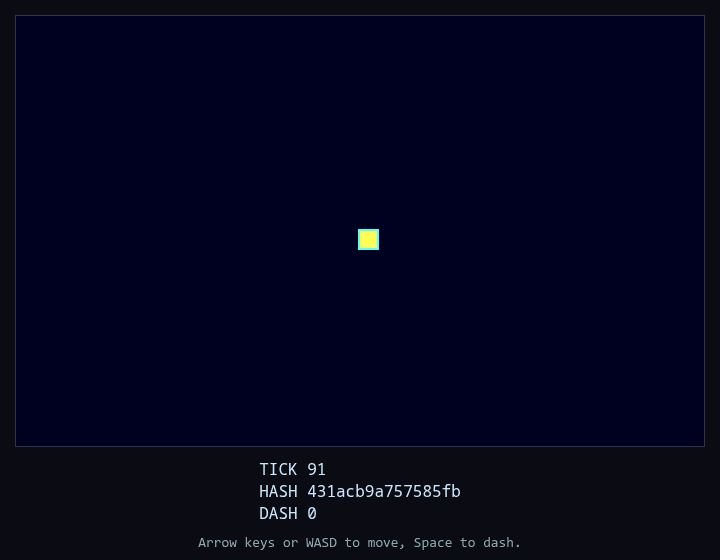

# Fixture Game — Player's Manual

A manual used only by the generator's tests. See [the other page](OTHER.md#part) and [a site](https://example.com).

## Controls

| Key | What it does |
| --- | --- |
| Space | Jump |

- `Esc` quits.

## The screen

## Unmapped

Text with {{braces}} that is not a placeholder.
